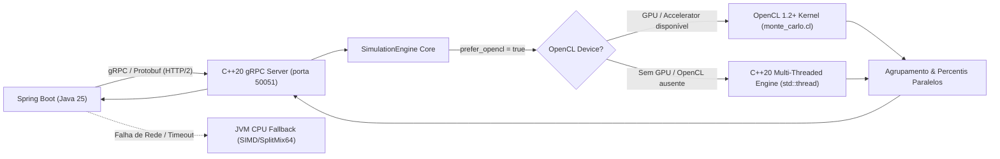

# Arquitetura e Paralelismo do Motor HPC em C++20 / OpenCL

Documento técnico do motor de computação de alto desempenho (**HPC Risk Simulation Engine**) localizado no diretório [`hpc-engine/`](file:///c:/projects/university/gestao-financeira/hpc-engine).

O motor é responsável por executar simulações estocásticas de **Monte Carlo com 100.000 a 1.000.000 de cenários** para projeção de fluxo de caixa corporativo, cálculo de **Value at Risk (VaR 99%)**, mediana (`P50`), probabilidade acumulada de ruína financeira e geração de **bandas de percentis diárias** (Cone de Incerteza).

---

## 1. Visão Geral da Arquitetura

O sistema emprega uma arquitetura desacoplada onde a aplicação Spring Boot 4 orquestra os dados de negócio e se comunica com o motor HPC via **gRPC sobre HTTP/2** utilizando Protobuf binário:



- **Protocolo de Comunicação:** gRPC / Protobuf v3 definido em [`src/main/proto/risk_simulation.proto`](file:///c:/projects/university/gestao-financeira/src/main/proto/risk_simulation.proto).
- **Padrão C++ Utilizado:** C++20 (`-std=c++20`), compilado com CMake 3.22+.
- **Resiliência e Tolerância a Falhas:** Caso o serviço gRPC externo esteja indisponível ou sofra timeout, a classe Java [`GrpcRiskSimulationAdapter`](file:///c:/projects/university/gestao-financeira/src/main/java/com/emanudev/gestaofinanceira/simulation/adapter/out/grpc/GrpcRiskSimulationAdapter.java) executa o algoritmo matemático equivalente localmente via Java Virtual Threads / Parallel Stream em CPU, garantindo 100% de disponibilidade.

---

## 2. Estratégia de Paralelismo e Concorrência

A simulação de Monte Carlo é um problema *Embarrassingly Parallel* (altamente paralelizável), pois a trajetória de cada cenário $s \in [0, N-1]$ é independente de qualquer outro. O motor explora essa propriedade em dois níveis:

### 2.1 Aceleração via OpenCL Kernel (`monte_carlo.cl`)

Quando compilado com `ENABLE_OPENCL=ON` e executado em ambiente com driver OpenCL (GPU NVIDIA, AMD, Intel ou Apple Silicon):

1. **Mapeamento Work-Item -> Cenário:** Cada *work-item* OpenCL processa exatamente uma trajetória estocástica completa ao longo de todo o horizonte temporal ($H \in \{30, 60, 90\}$ dias):
   ```c
   const int scenario_id = get_global_id(0);
   if (scenario_id >= num_scenarios) return;
   ```
2. **Layout de Memória Contíguo e *Coalesced Memory Access*:**
   - As matrizes de entrada (`payable_fixed_cents`, `payable_variable_cents`, `receivable_cents`) residem em buffers de leitura rápida (`CL_MEM_READ_ONLY | CL_MEM_COPY_HOST_PTR`).
   - A matriz de saldos de saída é linearizada como `daily_balances_out[day * num_scenarios + scenario_id]`, permitindo escrita contígua nos barramentos de memória da GPU.
3. **Flags de Ruína:** Cada cenário atualiza um byte atômico em `ruin_flags_out[scenario_id]` (1 se o saldo caiu abaixo de zero em qualquer dia do horizonte; 0 caso contrário).

### 2.2 Paralelismo Multi-Core em C++20 (`std::thread`)

Caso o ambiente não disponha de dispositivo OpenCL ou a compilação use o modo CPU:

- O motor detecta o hardware via `std::thread::hardware_concurrency()`.
- O espaço total de cenários ($N$) é particionado em *chunks* homogêneos de tamanho $\lceil N / T \rceil$, onde cada thread executa seu loop interno sem contenção de mutexes ou variáveis de condição.
- Cada thread gera números pseudoaleatórios em registradores locais de 64 bits sem acessar estado compartilhado, eliminando *false sharing*.

### 2.3 Redução Paralela de Bandas de Percentis

Após a conclusão dos cenários estocásticos, os saldos diários precisam ser ordenados para extrair os percentis diários (`P01`, `P05`, `P25`, `P50`, `P75`, `P95`):

- O motor distribui os $H$ dias do horizonte entre *worker threads* dedicadas (`band_workers = min(H, hardware_concurrency)`).
- Cada thread executa `std::sort` sobre o vetor de $N$ saldos de um dia específico ($O(N \log N)$ in-place) e calcula as posições quantílicas interpoladas sem alocações dinâmicas adicionais.

---

## 3. Modelo Matemático e Geradores Pseudoaleatórios (PRNG)

### 3.1 Inicialização e Independência de Sementes (`SplitMix64`)

Para garantir que os $N$ cenários sejam estatisticamente independentes e estritamente reprodutíveis dada uma semente base $S$, o motor utiliza o gerador `SplitMix64` no início de cada cenário:

$$\text{seed}_s = \text{SplitMix64}\left(S + (s + 1) \times \gamma\right)$$

Onde $\gamma = \text{0x9E3779B97F4A7C15}$ é a aproximação áurea de Weyl. Se o estado resultante for nulo, substitui-se por `0xCAFEBABE12345678`.

### 3.2 Geração Estocástica Rápida (`Xorshift64*`)

A cada passo diário do cenário, números uniformes $u \in [0, 1)$ são gerados com o algoritmo `Xorshift64*`, cuja latência é de apenas 3 instruções bitwise e uma multiplicação inteira:

```cpp
uint64_t xorshift64star(uint64_t& state) noexcept {
    uint64_t x = state;
    x ^= x >> 12;
    x ^= x << 25;
    x ^= x >> 27;
    state = x;
    return x * 0x2545F4914F6CDD1DULL;
}
```

A conversão para ponto flutuante de precisão dupla unitária é realizada sem divisão:
$$\text{to\_unit\_double}(x) = (x \gg 11) \times 2^{-53}$$

### 3.3 Choques Estocásticos de Liquidez

Em cada dia $t \in [1, H]$, o saldo $B_t$ evolui a partir de $B_{t-1}$:

1. **Choque de Inadimplência nos Recebíveis (Processo Bernoulli):**
   $$R_t^{\text{realizado}} = \begin{cases} 0, & \text{se } u_{\text{def}} < \text{defaultRate} \\ R_t, & \text{caso contrário} \end{cases}$$
2. **Choque Triangular nos Custos Variáveis:**
   A distribuição triangular simétrica com desvio para cima (+0.25) modela pressões inflacionárias de curto prazo:
   $$\text{shockMult} = \max\left(0.0,\; 1.0 + \text{costShock} \times \left((u_1 + u_2 - 1.0) + 0.25\right)\right)$$
   $$P_{\text{var}, t}^{\text{realizado}} = \text{round}\left(P_{\text{var}, t} \times \text{shockMult}\right)$$
3. **Atualização Recorrente do Saldo:**
   $$B_t = B_{t-1} + R_t^{\text{realizado}} - P_{\text{fixo}, t} - P_{\text{var}, t}^{\text{realizado}}$$
4. **Detecção de Ruína:** Se $B_t < 0$, o cenário é marcado como arruinado ($\text{ruined} = 1$).

### 3.4 Métricas Executivas de Risco

- **Value at Risk (VaR 99%):** Corresponde ao 1º percentil do saldo no último dia do horizonte ($H$):
  $$\text{VaR}_{99\%} = P01(B_H)$$
- **Mediana Esperada (P50):** $P50(B_H)$.
- **Probabilidade de Ruína:**
  $$\text{RuinPct} = \frac{\sum_{s=1}^N \text{ruined}_s}{N} \times 100\%$$

---

## 4. Contrato Protobuf (`risk_simulation.proto`)

```protobuf
syntax = "proto3";

package com.emanudev.gestaofinanceira.simulation.grpc;

option java_multiple_files = true;
option java_package = "com.emanudev.gestaofinanceira.simulation.adapter.out.grpc.proto";

service RiskSimulationService {
  rpc SimulateCashFlowRisk (RiskSimulationRequest) returns (RiskSimulationResponse);
}

message RiskSimulationRequest {
  sint64 initial_balance_cents = 1;
  int32 horizon_days = 2;
  int32 num_scenarios = 3;
  double expected_default_rate = 4;
  double variable_cost_shock_pct = 5;
  uint64 random_seed = 6;
  repeated ScheduledCashFlowItem scheduled_items = 7;
}

message ScheduledCashFlowItem {
  int32 day_offset = 1;
  sint64 payable_fixed_cents = 2;
  sint64 payable_variable_cents = 3;
  sint64 receivable_cents = 4;
}

message RiskSimulationResponse {
  sint64 var_99_cents = 1;
  sint64 median_p50_cents = 2;
  double ruin_probability_pct = 3;
  string execution_device = 4;
  int64 execution_time_ms = 5;
  repeated DailyProjectionBand daily_bands = 6;
}

message DailyProjectionBand {
  int32 day_offset = 1;
  sint64 p01_cents = 2;
  sint64 p05_cents = 3;
  sint64 p25_cents = 4;
  sint64 p50_cents = 5;
  sint64 p75_cents = 6;
  sint64 p95_cents = 7;
}
```

---

## 5. Instruções de Compilação e Execução

### 5.1 Pré-requisitos
- Compilador C++20 compatível (GCC 12+, Clang 15+ ou MSVC 2022 v19.34+).
- CMake 3.22+.
- OpenCL SDK (opcional, para GPU/aceleração via kernel).
- Protobuf 3.21+ e gRPC C++ Plugins (para o executável `hpc_grpc_server`).

### 5.2 Build Local via CMake
```bash
cd hpc-engine
mkdir -p build && cd build
cmake .. -DCMAKE_BUILD_TYPE=Release -DENABLE_OPENCL=ON -DBUILD_GRPC_SERVER=ON
cmake --build . --config Release --parallel
```

### 5.3 Execução dos Testes Unitários Nativos C++
```bash
ctest --output-on-failure
# ou
./simulation_engine_test
```

### 5.4 Inicialização do Servidor gRPC
```bash
export HPC_GRPC_PORT=50051
./hpc_grpc_server
```

### 5.5 Execução via Docker
O repositório inclui [`hpc-engine/Dockerfile`](file:///c:/projects/university/gestao-financeira/hpc-engine/Dockerfile) multi-stage baseado em Ubuntu 22.04 LTS para provisionamento conteinerizado do serviço gRPC.
