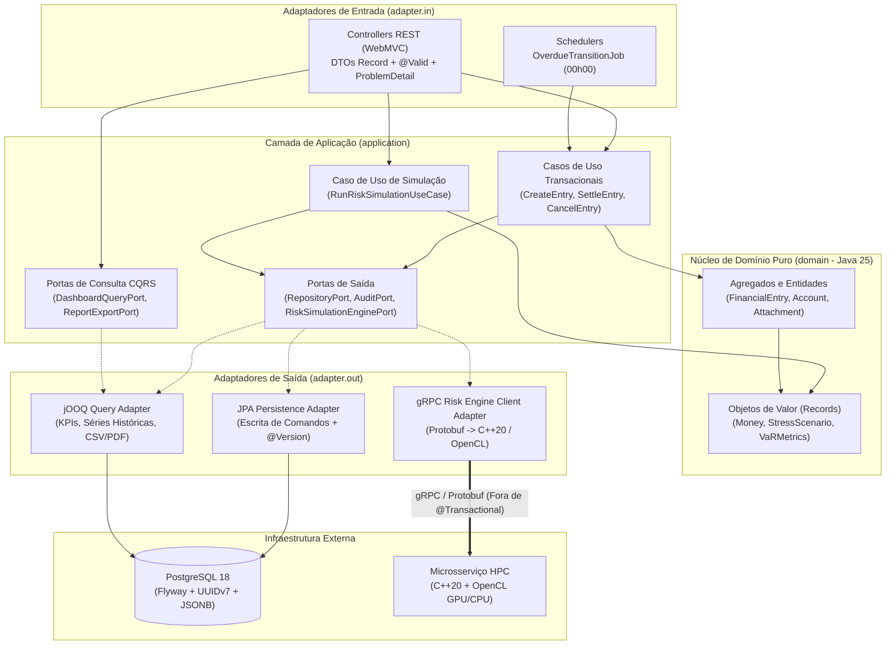
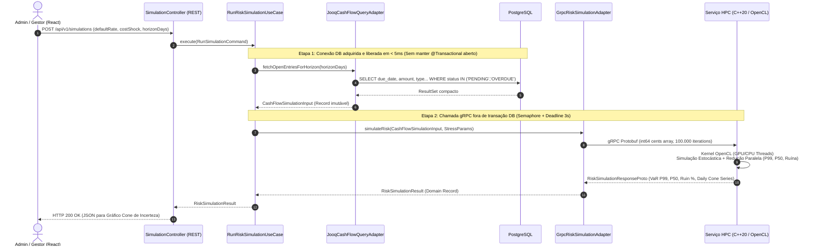

# Análise Crítica Estruturada do PRD — Sistema Integrado de Gestão Financeira Corporativa

- **Documento Analisado:** `PRD_Sistema_Gestao_Financeira.pdf` (Versão 1.0.0 — Release MVP, Setembro de 2026)
- **Contexto do Repositório:** `com.emanudev.gestaofinanceira` (`Java 25`, `Spring Boot 4.1.1`, `Spring WebMVC`, `gRPC / Protobuf`, `Spring Data JPA / Hibernate`, `jOOQ`, `Flyway`, `PostgreSQL`, `Bean Validation`, `OpenTelemetry + Micrometer + Prometheus + Grafana + Loki`, `Testcontainers`, `GraalVM Native Image`)
- **Guias Arquiteturais de Referência:** [JAVA_BEST_PRACTICES.md](./JAVA_BEST_PRACTICES.md), [HEXAGONAL_ARCHITECTURE.md](./HEXAGONAL_ARCHITECTURE.md) e [DATABASE_MIGRATIONS.md](./DATABASE_MIGRATIONS.md)

---

## Sumário

1. [Resumo Executivo do PRD Original](#1-resumo-executivo-do-prd-original)
   - [1.1 Visão Geral e Proposta de Valor](#11-visão-geral-e-proposta-de-valor)
   - [1.2 Perfis de Acesso e Matriz RBAC](#12-perfis-de-acesso-e-matriz-rbac)
   - [1.3 Módulos, Requisitos Funcionais e Regras de Negócio](#13-módulos-requisitos-funcionais-e-regras-de-negócio)
   - [1.4 Arquitetura de Referência e Requisitos Não Funcionais](#14-arquitetura-de-referência-e-requisitos-não-funcionais)
   - [1.5 Critérios de Aceite do MVP e Roadmap Pós-MVP](#15-critérios-de-aceite-do-mvp-e-roadmap-pós-mvp)
2. [Pontos Vagos, Ambiguidades e Lacunas de Especificação (Decisões Aprovadas)](#2-pontos-vagos-ambiguidades-e-lacunas-de-especificação-decisões-aprovadas)
   - [2.1 Modelagem Contábil, Precisão Monetária e Regimes Financeiros](#21-modelagem-contábil-precisão-monetária-e-regimes-financeiros)
   - [2.2 Máquina de Estados, Baixa Parcial (Split) e Estornos](#22-máquina-de-estados-baixa-parcial-split-e-estornos)
   - [2.3 Trilha de Auditoria, Soft Delete e Fechamento de Período](#23-trilha-de-auditoria-soft-delete-e-fechamento-de-período)
   - [2.4 Concorrência, Idempotência e Consistência Transacional](#24-concorrência-idempotência-e-consistência-transacional)
   - [2.5 Segurança, RBAC, Alçadas e Gestão de Anexos Fiscais](#25-segurança-rbac-alçadas-e-gestão-de-anexos-fiscais)
   - [2.6 Especificação Matemática e Computacional do Motor de Risco (HPC)](#26-especificação-matemática-e-computacional-do-motor-de-risco-hpc)
   - [2.7 Dashboard, Relatórios, Exportação e SLAs Operacionais](#27-dashboard-relatórios-exportação-e-slas-operacionais)
3. [Oportunidades de Melhoria na Arquitetura e no Escopo Proposto](#3-oportunidades-de-melhoria-na-arquitetura-e-no-escopo-proposto)
   - [3.1 Alinhamento com Arquitetura Hexagonal e CQRS Leve (JPA + jOOQ)](#31-alinhamento-com-arquitetura-hexagonal-e-cqrs-leve-jpa--jooq)
   - [3.2 Revisão Crítica da Auditoria via Spring AOP vs. Eventos de Domínio Transacionais](#32-revisão-crítica-da-auditoria-via-spring-aop-vs-eventos-de-domínio-transacionais)
   - [3.3 Fronteiras Transacionais e Integração gRPC com o Motor HPC (C++20 / OpenCL)](#33-fronteiras-transacionais-e-integração-grpc-com-o-motor-hpc-c20--opencl)
   - [3.4 Modelagem de Dados no PostgreSQL e Migrações Flyway](#34-modelagem-de-dados-no-postgresql-e-migrações-flyway)
   - [3.5 Observabilidade LGTM, Resiliência e Compatibilidade com GraalVM Native Image](#35-observabilidade-lgtm-resiliência-e-compatibilidade-com-graalvm-native-image)
   - [3.6 Ajustes de Escopo do MVP para Mitigação de Riscos](#36-ajustes-de-escopo-do-mvp-para-mitigação-de-riscos)
4. [Sugestões de Novas Funcionalidades (Features B2B / Mercado Corporativo)](#4-sugestões-de-novas-funcionalidades-features-b2b--mercado-corporativo)
   - [4.1 Multi-Tenancy, Multi-CNPJ (Matriz/Filiais) e Consolidação de Grupo](#41-multi-tenancy-multi-cnpj-matrizfiliais-e-consolidação-de-grupo)
   - [4.2 Plano de Contas Gerencial, Centros de Custo, Projetos e Rateio Contábil](#42-plano-de-contas-gerencial-centros-de-custo-projetos-e-rateio-contábil)
   - [4.3 Workflow de Aprovação em Múltiplas Alçadas (Maker-Checker)](#43-workflow-de-aprovação-em-múltiplas-alçadas-maker-checker)
   - [4.4 Gestão de Contas Bancárias Reais, Transferências e Conciliação (OFX, CNAB, Open Finance) — *[Estritamente Pós-MVP]*](#44-gestão-de-contas-bancárias-reais-transferências-e-conciliação-ofx-cnab-open-finance--estritamente-pós-mvp)
   - [4.5 Contas a Pagar/Receber Avançadas: Recorrência, Parcelamento e Retenções Fiscais](#45-contas-a-pagarreceber-avançadas-recorrência-parcelamento-e-retenções-fiscais)
   - [4.6 Ledger Imutável (Append-Only), Fechamento Contábil e DRE / Fluxo de Caixa Direto e Indireto](#46-ledger-imutável-append-only-fechamento-contábil-e-dre--fluxo-de-caixa-direto-e-indireto)
   - [4.7 Ecossistema de Integrações: Webhooks, API Pública com Idempotência e Exportação Contábil](#47-ecossistema-de-integrações-webhooks-api-pública-com-idempotência-e-exportação-contábil)

---

## 1. Resumo Executivo do PRD Original

### 1.1 Visão Geral e Proposta de Valor

O **PRD (Versão 1.0.0 — Release MVP)** especifica um **Sistema Integrado de Gestão Financeira Corporativa** voltado para Pequenas e Médias Empresas (PMEs). O diagnóstico central do produto é que o backoffice financeiro de PMEs sofre com fragmentação de dados (planilhas isoladas e sistemas CRUD passivos), ausência de trilha de auditoria confiável e incapacidade de prever crises de liquidez (visibilidade restrita ao saldo nominal passado).

A proposta de valor combina dois pilares:
1. **Gestão Transacional com Governança e Compliance:** controle de Contas a Pagar e a Receber com segregação estrita de funções (RBAC), travas operacionais para anexos fiscais, exclusão exclusivamente lógica (*Soft Delete*) e trilha de auditoria automática com *snapshot* de alterações (antes/depois).
2. **Motor Computacional de Simulação de Risco (HPC):** integração nativa com um microsserviço em **C++20 / OpenCL** acelerado por GPU/CPU via **gRPC / Protocol Buffers**, que executa o **Método de Monte Carlo** (mínimo de 100.000 cenários estocásticos) sobre a carteira de recebíveis e pagáveis para fornecer, em tempo real, o *Value at Risk* (VaR P99), o cenário base (Mediana P50), a probabilidade exata de ruína (quebra de caixa) e o gráfico de "Cone de Incerteza".

---

### 1.2 Perfis de Acesso e Matriz RBAC

O sistema define três perfis de acesso no modelo de Controle de Acesso Baseado em Funções (RBAC):

| Perfil (Role) | Atribuições na Jornada | Permissões Concedidas | Restrições Explícitas |
| :--- | :--- | :--- | :--- |
| **`ADMIN` / `GESTOR`** *(Administrador / Gestor Financeiro)* | Visão estratégica no dashboard completo, aprovação de pagamentos de alto valor, execução de simulações de risco (Monte Carlo) e gestão de acessos da equipe. | `LEITURA`, `ESCRITA`, `EXCLUSÃO LÓGICA`, `SIMULAÇÕES`, `ACESSO A LOGS` | Exclusão física (*Hard Delete*) é vedada em todo o sistema. |
| **`ANALISTA`** *(Analista Financeiro Operacional)* | Trabalho transacional diário: entrada de notas fiscais, cadastro de contas a pagar/receber, upload de comprovantes e baixa (liquidação) de contas. | `LEITURA`, `ESCRITA (CRIAÇÃO/STATUS)` | Proibido excluir registros (mesmo logicamente) e acessar ferramentas de simulação avançada. |
| **`AUDITOR`** *(Auditor / Contador)* | Conferência e fechamento mensal: exportação de relatórios, verificação de anexos fiscais e rastreamento de autoria de modificações em lançamentos. | `SOMENTE LEITURA (READ-ONLY)`, `ACESSO IRRESTRITO A LOGS` | Bloqueio total a inserções, edições, baixas ou exclusões cadastrais. |

---

### 1.3 Módulos, Requisitos Funcionais e Regras de Negócio

O escopo funcional do MVP está dividido em **4 módulos principais** e **11 regras de negócio (RNs)**:

#### Módulo 1: Compliance e Trilha de Auditoria (*Audit Trail*)
- **`RN01.1` — Imutabilidade de Registros Financeiros (*Soft Delete*):** Nenhuma transação financeira pode sofrer exclusão física (`DELETE` SQL) no banco de dados. A exclusão deve ser lógica, alterando o status do registro para `"Cancelado"`.
- **`RN01.2` — Rastreabilidade Automática (*Spring AOP Interceptor*):** Toda operação de `INSERT`, `UPDATE` ou `DELETE` lógico deve gerar obrigatoriamente um registro em tabela de logs contendo:
  - ID e Nome do Usuário autenticado;
  - Timestamp exato (Data e Hora);
  - Endereço IP do solicitante;
  - Identificação do registro alterado (ex.: `Conta a Pagar ID #1042`);
  - *Snapshot* dos dados (`Valor Anterior` vs. `Valor Novo`).

#### Módulo 2: Operação Financeira (Contas a Pagar e Receber)
- **`RN02.1` — Estrutura Obrigatória do Lançamento (Validação de Campos):** Campos obrigatórios para persistir uma conta: `Descrição`, `Valor Original`, `Data de Emissão`, `Data de Vencimento`, `Categoria (Centro de Custo)` e `Identificação da Contraparte (Fornecedor/Cliente)`.
- **`RN02.2` — Ciclo de Vida da Transação (Máquina de Estados):**
  - `Pendente`: data atual é menor ou igual à data de vencimento e sem liquidação;
  - `Atrasado`: data atual superou a data de vencimento e não há data de liquidação (o sistema deve atualizar esse status automaticamente todo dia à `00h00`);
  - `Liquidado`: transação paga ou recebida; exige preenchimento obrigatório de `"Data de Pagamento"` e `"Valor Pago"` (que pode diferir do valor original por juros ou descontos);
  - `Cancelado`: lançamento invalidado pelo Administrador (*Soft Delete*).
- **`RN02.3` — Baixa Parcial (*Split Automático*):** Caso uma conta (ex.: `R\$ 10.000,00`) receba pagamento parcial (ex.: `R\$ 4.000,00`), a transação original é marcada como `"Liquidada Parcialmente"` e um novo registro é gerado automaticamente com o saldo remanescente (`R\$ 6.000,00`), herdando o vencimento original ou solicitando uma nova data.
- **`RN02.4` — Gestão de Anexos Fiscais (Trava de Segurança):** Lançamentos pertencentes à categoria `"Impostos"` **ou** com valor superior a `R\$ 5.000,00` exigem obrigatoriamente o upload prévio de comprovante (`PDF`, `JPG` ou `PNG`) antes de permitir a transição de status para `"Liquidado"`.

#### Módulo 3: Simulação de Risco de Caixa (Motor de Monte Carlo)
- **`RN03.1` — Configuração de Cenários de Estresse:** Parâmetros configuráveis pelo Administrador antes de disparar a simulação:
  - *Taxa de Inadimplência Esperada*: percentual de chance de atraso nas Contas a Receber (ex.: `10%` a `30%`);
  - *Choque de Despesas Variáveis*: oscilação percentual esperada nos custos (ex.: aumento de até `15%`);
  - *Horizonte de Tempo*: `30`, `60` ou `90` dias futuros.
- **`RN03.2` — Geração de Cenários (A Lógica Numérica em Kernel OpenCL / GPU):** Geração de no mínimo **100.000 cenários aleatórios** (utilizando distribuição normal e variáveis de estresse), onde cada conta a pagar/receber futura tem sua data ou valor perturbados estocasticamente.
- **`RN03.3` — Saída de Dados (*Value at Risk*):** Retorno de três métricas estatísticas de negócio:
  - **Pior Cenário (`P99` / `VaR 99%`):** menor saldo possível com 99% de nível de confiança estatística;
  - **Probabilidade de Ruína (ex.: `14.5%`):** percentual exato de cenários em que o saldo de caixa da empresa fica negativo no horizonte simulado;
  - **Cenário Base (`P50` / Mediana):** fluxo de caixa projetado mais provável da organização.

#### Módulo 4: Dashboard Gerencial e Relatórios
- **`RN04.1` — KPIs em Tempo Real (Cockpit Executivo):** Exibição no topo do painel de: `Saldo Consolidado`, `Total a Receber Hoje`, `Total a Pagar Hoje` e `Índice de Inadimplência do Mês`.
- **`RN04.2` — Gráfico "Cone de Incerteza":** Gráfico de linhas interativo conectando o saldo histórico realizado (linha sólida) à projeção futura (linha mediana `P50` cercada por área sombreada representando a dispersão/`VaR` calculada pelo motor de Monte Carlo).
- **`RN04.3` — Exportação de Dados (`PDF` & `CSV`):** Qualquer filtro aplicado na tela de listagem de transações deve permitir exportação fiel em `PDF` e `CSV`, respeitando as colunas e filtros ativos na visão do usuário.

---

### 1.4 Arquitetura de Referência e Requisitos Não Funcionais

O PRD define uma arquitetura híbrida distribuída composta por:
1. **Frontend (Interface):** `React.js` com validação *client-side* e gráficos via `Recharts` ou `Chart.js`, comunicando-se com o backend via `REST / JSON` autenticado por `JWT Token`.
2. **Backend Core (Java):** `Java` + `Spring Boot`, `Spring Security (JWT)`, `Hibernate / Spring Data JPA`, `Spring AOP` (para interceptação invisível de auditoria) e `PostgreSQL` (com *Soft Delete*).
3. **Serviço Computacional Avançado (HPC):** Microsserviço isolado em `C++20` + `OpenCL` que recebe arrays de transações futuras e parâmetros de estresse e dispara centenas de milhares de threads em GPU/CPU.
4. **Comunicação Inter-serviços:** Exclusivamente via `gRPC` com `Protocol Buffers` entre o Backend Java e o Serviço HPC C++20, eliminando o overhead de serialização JSON para arrays numéricos.

---

### 1.5 Critérios de Aceite do MVP e Roadmap Pós-MVP

**Critérios de Aceite (Homologação pela Banca):**
1. **Segurança:** Bloqueio total a rotas financeiras sem token JWT válido e impedimento de exclusão de registros pelo perfil `ANALISTA`.
2. **Transacionalidade:** Execução íntegra de ponta a ponta do fluxo `Criar Conta -> Anexar Nota -> Liquidar Conta -> Verificar Log de Auditoria`.
3. **Processamento Paralelo Comprovado:** Execução bem-sucedida da simulação de Monte Carlo com 100.000 cenários via gRPC/OpenCL e renderização do risco no dashboard.
4. **Integridade de Dados:** Exclusão mantendo o registro no PostgreSQL (*Soft Delete*) e gerando log de auditoria com o estado anterior.

**Roadmap Pós-MVP:**
- **Fase 2 — Automação OCR de Ingestão de Dados:** Leitura de PDFs de notas fiscais via visão computacional para pré-preenchimento de contas a pagar.
- **Fase 3 — Conciliação Bancária (Open Finance):** Integração via APIs bancárias para baixa automática de lançamentos.
- **Fase 4 — Notificações Assíncronas:** Mensageria (ex.: RabbitMQ / e-mail) para alertar Gestores quando a probabilidade de ruína ultrapassar `15%`.

---

## 2. Pontos Vagos, Ambiguidades e Lacunas de Especificação (Decisões Aprovadas)

Abaixo apresenta-se a análise crítica das lacunas, contradições internas e subespecificações do PRD original, acompanhada da **Decisão Técnica Aprovada** para implementação em cada ponto.

### 2.1 Modelagem Contábil, Precisão Monetária e Regimes Financeiros

| ID | Ponto Subespecificado / Ambiguidade no PRD | Impacto se Não Resolvido | Decisão Técnica Aprovada |
| :--- | :--- | :--- | :--- |
| **GAP-FIN-01** | **Distinção entre Contas a Pagar (`AP`) e Contas a Receber (`AR`)** (`RN02.1`): O PRD trata ambas como uma única estrutura genérica ("salvar uma nova conta"), sem explicitar o discriminador de direção do fluxo de caixa (`PAYABLE` vs. `RECEIVABLE` ou `DEBIT` vs. `CREDIT`). | Mistura de sinais em cálculos de saldo, erro na aplicação da trava de inadimplência (que só afeta recebíveis) vs. choque de despesas (que só afeta pagáveis). | **Decisão Aprovada:** Modelar explicitamente o tipo de obrigação (`EntryType`: `PAYABLE` / `RECEIVABLE`) com valores originais estritamente positivos (`NUMERIC(19, 2) > 0`), determinando o sinal algébrico no cálculo de fluxo de caixa pelo tipo da operação. |
| **GAP-FIN-02** | **Origem do "Saldo Consolidado"** (`RN04.1` e `RN03.3`): O PRD exige exibir o "Saldo Consolidado" e calcular quando o "saldo da empresa fica negativo", mas **não especifica a existência de Contas Financeiras nem Saldo Inicial**. | É impossível saber se o Saldo Consolidado é a soma desde o início dos tempos ($\sum \text{Recebidos} - \sum \text{Pagos}$) ou se parte de um saldo inicial configurado. | **Decisão Aprovada:** Criar a entidade interna `FinancialAccount` (Carteira / Conta Caixa Virtual, **sem nenhuma integração bancária real nem movimentação de dinheiro real no MVP**) com saldo inicial auditado e vincular toda liquidação a essa carteira interna. |
| **GAP-FIN-03** | **Juros, Multa, Descontos e Acréscimos na Liquidação** (`RN02.2`): O PRD diz que o `"Valor Pago"` pode diferir do `"Valor Original"` devido a juros/descontos, mas não diz se juros, multa e descontos são informados separadamente ou apenas embutidos no valor final, nem como distinguir **diferença por juros/desconto** de uma **Baixa Parcial (`RN02.3`)**! | **Ambiguidade Crítica:** Se uma conta de `R\$ 10.000,00` recebe `R\$ 9.500,00`, foi uma **liquidação integral com `R\$ 500,00` de desconto** (`RN02.2`) ou uma **baixa parcial de `R\$ 9.500,00`** gerando residual de `R\$ 500,00` (`RN02.3`)? | **Decisão Aprovada:** Na operação de liquidação, exigir campos explícitos: `principalPaid` (valor abatido do principal), `interestAmount` (juros), `penaltyAmount` (multa) e `discountAmount` (desconto), onde $\text{Valor Pago} = \text{principalPaid} + \text{juros} + \text{multa} - \text{desconto}$. Se $\text{principalPaid} < \text{Valor Original}$, aciona-se o *split* (`RN02.3`) para a diferença do principal. |
| **GAP-FIN-04** | **Precisão Numérica, Escala e Arredondamento**: O PRD não define a escala decimal, a moeda nem o modo de arredondamento (`RoundingMode`) para cálculos de taxas, índices de inadimplência e simulações. | Divergência de centavos entre Java (`BigDecimal`) e C++ (`float`/`double` na GPU), violando [COR-01](./JAVA_BEST_PRACTICES.md#cor-01-valores-monetários-em-ponto-flutuante) e [MIG-02](./DATABASE_MIGRATIONS.md#mig-02-ponto-flutuante-ou-tipo-money-para-valores-financeiros). | **Decisão Aprovada:** No Java e PostgreSQL, usar `BigDecimal` / `NUMERIC(19, 2)` para valores monetários com `RoundingMode.HALF_EVEN` (ABNT NBR 5891) e código ISO-4217 (`VARCHAR(3)`, padrão `'BRL'`). No contrato gRPC para o motor HPC, trafegar valores em **centavos inteiros de 64 bits (`int64` / `sint64`)** ou ponto fixo escalado, evitando perda de precisão na serialização. |
| **GAP-FIN-05** | **Regime de Competência vs. Regime de Caixa** (`RN02.1`, `RN04.1`): O lançamento possui `Data de Emissão`, `Data de Vencimento` e `Data de Pagamento`, mas não há `Data de Competência` explícita nem definição de qual data rege cada métrica do dashboard. | Relatórios contábeis (Auditores/Contadores) operam por competência, enquanto Tesouraria e Simulação de Risco operam por caixa/vencimento. | **Decisão Aprovada:** Incluir `competence_date` (`DATE`, defaulting para a data de emissão se omitida) para relatórios gerenciais/contábeis e utilizar `due_date` / `payment_date` para fluxo de caixa e simulação de risco. |
| **GAP-FIN-06** | **Fórmula do "Índice de Inadimplência do Mês"** (`RN04.1`): O KPI é exigido no topo do painel, mas sua fórmula matemática não existe no PRD. | Diferentes desenvolvedores implementarão fórmulas distintas (por quantidade de títulos vs. por volume financeiro; sobre o mês de vencimento vs. carteira total). | **Decisão Aprovada:** Padronizar a fórmula financeira de mercado: $$\text{Índice de Inadimplência Mensal} = \frac{\sum \text{Valor dos Recebíveis Vencidos no Mês e Não Liquidados}}{\sum \text{Valor Total dos Recebíveis com Vencimento no Mês}} \times 100$$ considerando apenas títulos `RECEIVABLE` não cancelados. |

---

### 2.2 Máquina de Estados, Baixa Parcial (Split) e Estornos

| ID | Ponto Subespecificado / Ambiguidade no PRD | Impacto se Não Resolvido | Decisão Técnica Aprovada |
| :--- | :--- | :--- | :--- |
| **GAP-STA-01** | **Inconsistência na Máquina de Estados (`RN02.2` vs. `RN02.3`)**: A `RN02.2` lista 4 estados (`Pendente`, `Atrasado`, `Liquidado`, `Cancelado`), mas a `RN02.3` introduz um **5º estado** (`"Liquidada Parcialmente"`) que não consta na máquina de estados da `RN02.2`. | Quebra de `CHECK` constraints no banco e de `switch` exaustivos no Java se o estado `PARTIALLY_SETTLED` não for formalizado. | **Decisão Aprovada:** Formalizar todos os estados no enum de domínio `TransactionStatus`: `PENDING`, `OVERDUE`, `PARTIALLY_SETTLED`, `SETTLED`, `CANCELLED` (e opcionalmente `PENDING_APPROVAL` — ver GAP-SEC-02). |
| **GAP-STA-02** | **Comportamento Contábil do Split na Baixa Parcial (`RN02.3`)**: Quando uma conta de `R\$ 10.000` sofre baixa parcial de `R\$ 4.000`, ela vira `"Liquidada Parcialmente"` e um novo registro de `R\$ 6.000` é criado. Se o registro original continuar com `Valor Original = R\$ 10.000` e `Valor Pago = R\$ 4.000`, a soma dos valores originais no banco passará a ser `R\$ 16.000`! | **Dupla contagem grave** em relatórios de faturamento/despesas e no painel gerencial se os lançamentos pai e filho forem somados ingenuamente. | **Decisão Aprovada:** O registro original tem `original_amount = 10000.00`, `settled_amount = 4000.00` e status `PARTIALLY_SETTLED` (sendo um estado terminal para aquela parcela). O novo registro filho (`parent_transaction_id = id_original`) nasce com `original_amount = 6000.00` e status `PENDING`. Consultas de "Total em Aberto" somam apenas `PENDING` e `OVERDUE`; consultas de "Total Liquidado" somam `settled_amount` de `SETTLED` e `PARTIALLY_SETTLED`. |
| **GAP-STA-03** | **Trava de Anexo Fiscal (`RN02.4`) em Baixas Parciais (`RN02.3`)**: Uma conta de `R\$ 8.000,00` (acima do limite de `R\$ 5.000,00`) é dividida em duas baixas parciais de `R\$ 4.000,00`. Isso burla a obrigatoriedade do comprovante fiscal? E o anexo do registro pai é herdado pelo registro filho gerado no *split*? | Fraude operacional (*smurfing* / fracionamento de pagamentos para escapar da trava de compliance de `R\$ 5.000,00`). | **Decisão Aprovada:** A regra de exigência de comprovante (`> R\$ 5.000,00` ou categoria `Impostos`) deve avaliar o **valor original da obrigação raiz** (`root_original_amount >= 5000.00`) **ou** o valor sendo liquidado, exigindo o anexo já na primeira baixa parcial e vinculando os anexos da conta pai automaticamente às contas filhas geradas por *split*. |
| **GAP-STA-04** | **Job Diário à `00h00` para Status `Atrasado` (`RN02.2`)**: O PRD exige atualização automática todo dia à `00h00`. Não especifica qual fuso horário define `00h00`, o que ocorre se o servidor estiver desligado à meia-noite ou se uma conta já for cadastrada com data de vencimento no passado (retroativa). | Contas cadastradas retroativamente ficariam como `Pendente` até a meia-noite; falha no job agendado deixaria KPIs de inadimplência incorretos durante o dia. | **Decisão Aprovada:** (1) Ao criar/editar lançamento com `due_date < LocalDate.now(clock)`, já instanciar diretamente como `OVERDUE`; (2) fuso horário de negócio configurável (padrão `America/Sao_Paulo` para corte diário); (3) Job idempotente executado à `00h00` **e** na inicialização da aplicação (`ApplicationReadyEvent`), além de cálculo dinâmico nas queries de leitura (`jOOQ`). |
| **GAP-STA-05** | **Ausência de Fluxo de Estorno / Reabertura e Edição Pós-Liquidação**: O PRD não especifica se um lançamento `Liquidado` ou `Cancelado` pode ser editado, excluído logicamente ou estornado caso o Analista tenha digitado o valor pago errado. | Se um lançamento `Liquidado` puder sofrer `UPDATE` livre ou ser `Cancelado` sem estorno, o saldo consolidado passado muda silenciosamente, destruindo a confiabilidade contábil. | **Decisão Aprovada:** Bloquear edição de campos financeiros (`valor`, `vencimento`, `contraparte`) em lançamentos `SETTLED`, `PARTIALLY_SETTLED` ou `CANCELLED`. Cancelar ou corrigir uma liquidação exige uma operação explícita de **Estorno (`Reversal`)**, restrita ao perfil `ADMIN/GESTOR` com justificativa obrigatória. |

---

### 2.3 Trilha de Auditoria, Soft Delete e Fechamento de Período

| ID | Ponto Subespecificado / Ambiguidade no PRD | Impacto se Não Resolvido | Decisão Técnica Aprovada |
| :--- | :--- | :--- | :--- |
| **GAP-AUD-01** | **Proteção da Própria Tabela de Auditoria (`RN01.2`)**: O PRD exige que logs registrem toda alteração, mas não especifica mecanismos no banco para impedir `UPDATE` ou `DELETE` na própria tabela de logs (`audit_logs`), nem como auditar ações feitas pelo próprio sistema (ex.: job da `00h00`). | Um usuário com acesso ao banco ou falha de código poderia adulterar os logs de auditoria; o job da `00h00` falharia se `user_id` e `ip_address` fossem `NOT NULL` sem um ator de sistema definido. | **Decisão Aprovada:** (1) Configurar a tabela `audit_logs` como *append-only* (trigger no PostgreSQL proibindo `UPDATE`/`DELETE` e opcionalmente encadeamento de hash SHA-256 entre registros); (2) Para jobs automáticos, registrar `actor_type = 'SYSTEM'`, `user_name = 'SYSTEM_SCHEDULER'` e IP `'127.0.0.1'`. |
| **GAP-AUD-02** | **Formato do Snapshot (`Valor Anterior` vs. `Valor Novo`) e LGPD**: O PRD pede *snapshot* dos dados, mas não define o esquema nem o mascaramento de dados sensíveis. | Gravar `toString()` de entidades JPA gera erro de `LazyInitializationException` ([COR-02](./JAVA_BEST_PRACTICES.md#cor-02-equals-hashcode-e-lombok-incorretos-em-entidades-jpa)) e texto não pesquisável. | **Decisão Aprovada:** Armazenar `previous_state` e `new_state` em colunas `JSONB` no PostgreSQL (indexáveis via GIN se necessário), serializadas a partir do estado de domínio imutável (nunca da entidade JPA). |
| **GAP-AUD-03** | **Fechamento Mensal pelo Auditor (`Seção 2 - Jornada do Auditor`)**: O PRD cita que o Auditor *"acessa a plataforma no fim do mês para fechamento e conferência"*, mas não há nenhuma RN no Módulo 1 ou 2 que implemente a trava de fechamento de período contábil (*Period Closing*). | Analistas podem inserir ou alterar lançamentos com data retroativa em meses já conferidos e fechados pelo Contador. | **Decisão Aprovada:** Implementar o conceito de **Fechamento de Competência (`AccountingPeriod`)**: uma vez que um mês/ano é marcado como `CLOSED`, qualquer lançamento ou liquidação com data naquele período é rejeitado pelo domínio. |

---

### 2.4 Concorrência, Idempotência e Consistência Transacional

| ID | Ponto Subespecificado / Ambiguidade no PRD | Impacto se Não Resolvido | Decisão Técnica Aprovada |
| :--- | :--- | :--- | :--- |
| **GAP-CON-01** | **Condições de Corrida em Baixas Simultâneas**: Dois analistas clicam em "Liquidar" (ou "Baixa Parcial") para a mesma conta ao mesmo tempo. | Dupla liquidação e geração de dois registros filhos de *split*, duplicando a dívida ou o pagamento ([CON-01](./JAVA_BEST_PRACTICES.md#con-01-estado-mutável-em-beans-singleton-e-condições-de-corrida)). | **Decisão Aprovada:** Uso obrigatório de coluna `version BIGINT NOT NULL DEFAULT 0` (`@Version` / Lock Otimista) na tabela de transações financeiras, retornando `HTTP 409 Conflict` (`ProblemDetail`) em caso de modificação concorrente. |
| **GAP-CON-02** | **Ausência de Chaves de Idempotência em Comandos Financeiros**: Retentativas de rede no cliente HTTP ao criar uma conta ou registrar um pagamento parcial. | Criação de lançamentos duplicados em caso de *timeout* de rede ou duplo clique ([Seção 5.4 de DATABASE_MIGRATIONS.md](./DATABASE_MIGRATIONS.md#54-chaves-de-idempotência-no-banco-para-mutações-financeiras)). | **Decisão Aprovada:** Exigir cabeçalho `Idempotency-Key` (ou campo no comando) persistido com constraint `UNIQUE` no PostgreSQL para criação de lançamentos e liquidações. |

---

### 2.5 Segurança, RBAC, Alçadas e Gestão de Anexos Fiscais

| ID | Ponto Subespecificado / Ambiguidade no PRD | Impacto se Não Resolvido | Decisão Técnica Aprovada |
| :--- | :--- | :--- | :--- |
| **GAP-SEC-01** | **Ciclo de Vida de Autenticação JWT**: O PRD menciona `Spring Security (JWT)`, mas não define algoritmo de assinatura, tempo de expiração (`TTL`), *refresh token*, revogação/bloqueio de usuário, política de senha nem bootstrap do primeiro usuário `ADMIN`. | Tokens eternos ou sem possibilidade de revogação imediata quando um funcionário do financeiro é desligado. | **Decisão Aprovada:** JWT assinado com `RS256` ou `HS256` (chave via variável de ambiente — [SEC-02](./JAVA_BEST_PRACTICES.md#sec-02-segredos-no-código-configurações-ou-logs)), Access Token curto (`15 min`), Refresh Token rotativo revogável no banco e verificação do status `ACTIVE` do usuário. |
| **GAP-SEC-02** | **"Aprovação de Pagamentos de Alto Valor" pelo Gestor (`Seção 2`) sem Regra no Módulo 2**: Na matriz RBAC (pág. 2), o PRD afirma que o `ADMIN / GESTOR` *"aprova pagamentos de alto valor"*, porém o Módulo 2 não define qual é o valor de corte, nem o estado `"Aguardando Aprovação"`, permitindo que o `ANALISTA` liquide qualquer conta diretamente! | Contradição direta entre a Matriz de Governança (pág. 2) e a Máquina de Estados (pág. 3). | **Decisão Aprovada:** Parametrizar o limite de alçada (default `R\$ 5.000,00`): pagamentos acima desse valor não podem ser liquidados diretamente pelo `ANALISTA` sem aprovação prévia de um `ADMIN/GESTOR` (ou exigir que a liquidação de alto valor seja executada/aprovada pelo Gestor). |
| **GAP-SEC-03** | **Armazenamento, Limite de Tamanho e Segurança de Anexos Fiscais (`RN02.4`)**: O PRD exige upload de `PDF`, `JPG` ou `PNG`, mas não especifica onde os arquivos são salvos (Filesystem, S3/MinIO ou `BYTEA` no banco), tamanho máximo, validação de *Magic Bytes* (evitar executável `.exe` renomeado para `.pdf`) nem imutabilidade do anexo após a liquidação. | Vulnerabilidade de upload arbitrário, esgotamento de disco/memória da JVM ou substituição fraudulenta de um comprovante fiscal após a auditoria. | **Decisão Aprovada:** (1) Abstrair via porta de saída `AttachmentStoragePort` (implementação local/S3-compatible e metadados no PostgreSQL com hash `SHA-256` do arquivo); (2) Validar tamanho máximo (ex.: `10 MB`) e *Magic Bytes* reais (`%PDF-`, `\xFF\xD8\xFF`, `\x89PNG`); (3) Proibir exclusão ou substituição de anexos de transações já `SETTLED`. |

---

### 2.6 Especificação Matemática e Computacional do Motor de Risco (HPC)

| ID | Ponto Subespecificado / Ambiguidade no PRD | Impacto se Não Resolvido | Decisão Técnica Aprovada |
| :--- | :--- | :--- | :--- |
| **GAP-HPC-01** | **Indefinição do Modelo Estocástico (`RN03.1` e `RN03.2`)**: O PRD diz que o motor gera 100.000 cenários *"usando a distribuição normal e as variáveis de estresse onde cada conta a pagar/receber tem sua data ou valor levemente alterados"*, mas não define a **equação matemática exata**! | O engenheiro C++ não tem como implementar o kernel OpenCL sem saber: (a) A "Taxa de Inadimplência Esperada" ($p \in [0, 1]$) é modelada como um ensaio de **Bernoulli** por título recebível (se sortear atraso, atrasa quantos dias? ou vira perda total no horizonte?)? (b) O "Choque de Despesas Variáveis" ($\sigma$) é a média $\mu$ ou o desvio padrão $\sigma$ da Distribuição Normal $\mathcal{N}(\mu, \sigma^2)$? Quais categorias são despesas "variáveis" vs. "fixas"? | **Decisão Aprovada (Especificação Matemática Formal):** Para cada simulação $k \in \{1, \dots, N\}$ ($N \ge 100.000$) no horizonte $H \in \{30, 60, 90\}$ dias a partir do saldo inicial $S_0$:  1. **Recebíveis ($i$):** Sorteia-se $U_{k,i} \sim \text{Uniform}(0, 1)$. Se $U_{k,i} < p_{\text{inadimplência}}$, o título sofre atraso estocástico $\Delta d_{k,i} \sim \lfloor |\mathcal{N}(\mu_d, \sigma_d^2)| \rfloor$ dias (se a nova data $d_i + \Delta d_{k,i} > H$, o fluxo não entra no caixa dentro do horizonte $H$). 2. **Pagáveis Variáveis ($j$):** O valor desembolsado é perturbado por $V_{k,j} = V_j \cdot \max(0, 1 + Z_{k,j})$, onde $Z_{k,j} \sim \mathcal{N}(\mu_{\text{choque}}, \sigma_{\text{choque}}^2)$ truncada. 3. **Trajetória Diária de Caixa:** $S_k(t) = S_0 + \sum_{d \le t} \text{Recebimentos}_k(d) - \sum_{d \le t} \text{Pagamentos}_k(d)$ para $t \in \{1, \dots, H\}$. |
| **GAP-HPC-02** | **Definição de "Probabilidade de Ruína" e "VaR P99" (`RN03.3` e `RN04.2`)**: (a) "Ruína" significa saldo negativo **no último dia** do horizonte ($S_k(H) < 0$) ou em **qualquer dia** dentro do horizonte ($\min_{t \in [1, H]} S_k(t) < 0$ — *First-Passage Ruin*)? (b) O "Cone de Incerteza" (`RN04.2`) precisa das bandas percentílicas **dia a dia** ($t = 1 \dots H$), mas a `RN03.3` menciona retornar apenas 3 números escalares! | Se o serviço gRPC C++ retornar apenas 3 números escalares finais, o Frontend React **não conseguirá desenhar o gráfico "Cone de Incerteza"** (`RN04.2`) ao longo dos 30/60/90 dias! | **Decisão Aprovada:** (1) Definir Probabilidade de Ruína como **Ruína de Primeira Passagem** ($P(\min_{1 \le t \le H} S_k(t) < 0)$), pois na vida real uma empresa quebra se ficar sem caixa no dia 15, mesmo que tenha recebíveis no dia 28; (2) No contrato Protobuf (`gRPC`), retornar tanto as métricas globais consolidadas quanto o **vetor de séries temporais diárias** (`repeated DailyProjectionPoint` para $t = 1 \dots H$ contendo `date`, `p50_balance`, `p10_balance`, `p90_balance`, `p01_var99_balance`, `daily_ruin_probability`). |
| **GAP-HPC-03** | **Reprodutibilidade Científica (PRNG Seed) e Fallback de Hardware (GPU -> CPU)**: O PRD exige OpenCL em GPU, mas ambientes de CI/CD (GitHub Actions, containers Docker padrão) ou máquinas da banca avaliadora podem não ter GPU dedicada disponível. Além disso, sem *seed* fixa no gerador pseudoaleatório (ex.: *Philox* ou *Xoroshiro128+* em OpenCL), testes automatizados serão não-determinísticos. | Falha fatal (`CL_DEVICE_NOT_FOUND`) na apresentação para a banca ou nos testes de integração se não houver GPU; testes quebrando por variação estatística. | **Decisão Aprovada:** (1) O serviço C++20/OpenCL deve implementar *fallback* transparente na seleção de dispositivo: tentar `CL_DEVICE_TYPE_GPU`, depois `CL_DEVICE_TYPE_CPU` via OpenCL runtime (ex.: PoCL / Intel / AMD OpenCL CPU), e por fim *fallback* em threads nativas C++20 (`std::jthread` / SIMD) caso nenhum driver OpenCL exista no host; (2) Incluir campo opcional `optional uint64 random_seed` no Protobuf para garantir reprodutibilidade determinística em testes e auditorias. |

---

### 2.7 Dashboard, Relatórios, Exportação e SLAs Operacionais

| ID | Ponto Subespecificado / Ambiguidade no PRD | Impacto se Não Resolvido | Decisão Técnica Aprovada |
| :--- | :--- | :--- | :--- |
| **GAP-REP-01** | **Paginação, Ordenação e Limites de Exportação (`RN04.3`)**: O PRD exige listagem e exportação `PDF`/`CSV` respeitando filtros, mas não define paginação na listagem nem limite de linhas na exportação síncrona. | Carregar dezenas de milhares de lançamentos na memória da JVM para gerar um PDF síncrono causará `OutOfMemoryError` ([PER-01](./JAVA_BEST_PRACTICES.md#per-01-consultas-n1-io-em-laços-e-transações-longas)). | **Decisão Aprovada:** Paginação obrigatória nas APIs de listagem (`page`, `size` máx. `100`); streaming direto na geração de `CSV` via jOOQ Cursor/Stream (`try-with-resources` — [COR-04](./JAVA_BEST_PRACTICES.md#cor-04-recursos-externos-e-streams-de-consulta-não-fechados)) e limite seguro (ex.: `10.000` registros) para exportação `PDF` síncrona. |
| **GAP-REP-02** | **Ausência de SLAs / SLOs Quantitativos (Requisitos Não Funcionais)**: O PRD fala em "tempo real" e "alta performance", mas não define latências máximas (`p95`, `p99`) nem vazão (`RPS`). | Sem métricas objetivas, a "aferição de performance no ambiente de homologação" exigida na página 6 do PRD fica subjetiva. | **Decisão Aprovada:** Estabelecer SLOs formais aferíveis via Micrometer/Prometheus:  - Endpoints transacionais REST (`p95 < 150ms`, `p99 < 300ms`); - Dashboard KPIs via jOOQ (`p95 < 100ms`); - Simulação de risco 100.000 cenários via gRPC (`p95 < 800ms` em GPU, `< 2500ms` em CPU multicore). |

---

## 3. Oportunidades de Melhoria na Arquitetura e no Escopo Proposto

O repositório já dispõe de uma fundação moderna de altíssimo nível (`Java 25`, `Spring Boot 4.1.1`, `WebMVC`, `gRPC`, `Spring Data JPA`, `jOOQ`, `Flyway`, `PostgreSQL`, `OpenTelemetry/Micrometer`, `Testcontainers` e `GraalVM Native Image`) e guias arquiteturais estritos ([HEXAGONAL_ARCHITECTURE.md](./HEXAGONAL_ARCHITECTURE.md), [JAVA_BEST_PRACTICES.md](./JAVA_BEST_PRACTICES.md) e [DATABASE_MIGRATIONS.md](./DATABASE_MIGRATIONS.md)). Contudo, a seção 5 do PRD (*Escopo Técnico e Arquitetura*) propõe algumas abordagens que conflitam com boas práticas modernas ou subutilizam a stack já configurada no `pom.xml`.

### 3.1 Alinhamento com Arquitetura Hexagonal e CQRS Leve (JPA + jOOQ)

O PRD menciona apenas `Hibernate / Spring Data JPA` para todo o acesso a dados. No entanto, o projeto já possui o **`spring-boot-starter-jooq`** configurado e adota **CQRS leve** em Arquitetura Hexagonal ([Seção 1.7 de HEXAGONAL_ARCHITECTURE.md](./HEXAGONAL_ARCHITECTURE.md#1-regras-de-decisão-e-desambiguação)):

1. **Separação de Escrita (Command) e Leitura (Query):**
   - **Lado de Escrita (`Command` via Spring Data JPA):** Criação de contas, liquidação, baixa parcial (*split*), upload de anexo fiscal e cancelamento lógico devem passar por **Entidades de Domínio ricas e puras em Java 25** (sem anotações do Hibernate — [HEX-01](./HEXAGONAL_ARCHITECTURE.md#hex-01-domínio-dependente-de-frameworks-ou-infraestrutura)), orquestradas por Casos de Uso (`*UseCase`) e persistidas via adaptadores JPA *package-private*.
   - **Lado de Leitura (`Query` via jOOQ):** Os KPIs em tempo real do Cockpit Executivo (`RN04.1`), o histórico de saldos diários para o gráfico "Cone de Incerteza" (`RN04.2`), a extração do vetor de títulos em aberto para alimentar o motor de Monte Carlo (`RN03.2`), a consulta de logs de auditoria (`RN01.2`) e a exportação `CSV`/`PDF` (`RN04.3`) devem usar **jOOQ (`DSLContext`)** projetando diretamente em `records` imutáveis.
   - **Benefício:** Elimina completamente o overhead de *dirty checking* e hidratação de grafos de entidades do Hibernate nas consultas analíticas e na preparação do payload gRPC para o C++20.

2. **Organização Modular por Contextos Delimitados (*Package-by-Feature*):**
   Em vez de um pacote monolítico por camadas técnicas, estruturar o repositório em contextos de negócio independentes seguindo [Seção 4 de HEXAGONAL_ARCHITECTURE.md](./HEXAGONAL_ARCHITECTURE.md#4-organização-de-pacotes):

---

### 3.2 Revisão Crítica da Auditoria via Spring AOP vs. Eventos de Domínio Transacionais

A `RN01.2` do PRD sugere implementar a auditoria com **`Spring AOP Interceptor`** para *"interceptar as requisições de modificação no banco de forma invisível para as classes de negócio"*. Como Engenheiro Sênior e Arquiteto, é fundamental apontar os **três graves problemas técnicos** de um interceptador AOP genérico sobre repositórios JPA e propor a implementação correta com Spring AOP orientada a casos de uso:

> [!WARNING]
> **Riscos de Interceptar Repositórios JPA diretamente via AOP para Snapshot Antes/Depois:**
> 1. **Perda do "Valor Anterior" no Cache de 1º Nível do Hibernate:** Quando o caso de uso carrega a entidade JPA, muta seus atributos na memória e chama `repository.save(entity)`, a instância no contexto de persistência (`PersistenceContext`) **já foi mutada**. Um aspecto `@Around("execution(* *Repository.save(..))")` que tente buscar o "valor anterior" com `findById` receberá do cache de 1º nível do Hibernate a **própria instância já modificada**, gravando `Valor Anterior == Valor Novo`!
> 2. **Acoplamento à Infraestrutura de Transporte (`IP` e `Usuário`):** A camada de persistência não deve conhecer `HttpServletRequest` (para extrair o IP) nem `SecurityContextHolder`.
> 3. **Compatibilidade com GraalVM Native Image:** Pointcuts AspectJ dinâmicos ou reflexão profunda em campos privados de entidades JPA quebram facilmente na compilação AOT da GraalVM ([Seção 3 de JAVA_BEST_PRACTICES.md](./JAVA_BEST_PRACTICES.md#3-compatibilidade-e-configuração-do-projeto)).

**Arquitetura Recomendada (Atendendo ao requisito de AOP do PRD com Segurança e Precisão):**
- **Anote os Casos de Uso de Mutação** na camada `application` com uma anotação semântica explícita (ex.: `@AuditedFinancialAction(action = AuditAction.SETTLE_ENTRY)`) ou combine o Aspecto AOP na fronteira do Caso de Uso com um **`AuditTrailPort`** explícito:
  1. Um filtro web (`AuditContextFilter`) captura o `IP do cliente`, `User-Agent`, `TraceId` e dados do `JWT` e disponibiliza em um port de contexto (`RequestAuditContextPort`).
  2. Antes de aplicar a mutação no agregado de domínio (`entry.settle(...)`), o estado imutável original do domínio (`EntrySnapshot.from(entry)`) é capturado em memória (sem query extra ao banco!).
  3. Após a mutação (`EntrySnapshot.from(mutatedEntry)`), o Aspecto / Caso de Uso registra o evento de auditoria na **mesma transação PostgreSQL** (`@Transactional` `REQUIRED`), garantindo que **nenhuma alteração financeira seja comitada se a gravação do log de auditoria falhar** (atomicidade total entre operação e trilha de auditoria).

---

### 3.3 Fronteiras Transacionais e Integração gRPC com o Motor HPC (C++20 / OpenCL)

De acordo com os anti-patterns [HEX-14](./HEXAGONAL_ARCHITECTURE.md#hex-14-transações-abertas-além-do-limite-necessário) e [PER-01](./JAVA_BEST_PRACTICES.md#per-01-consultas-n1-io-em-laços-e-transações-longas), chamadas de rede externas **nunca devem ocorrer dentro de uma transação `@Transactional` aberta com o banco de dados**, sob pena de esgotar o pool de conexões HikariCP enquanto a GPU processa os 100.000 cenários.

**Fluxo Arquitetural Recomendado para o Caso de Uso de Simulação (`RunRiskSimulationUseCase`):**
1. **Etapa 1 — Leitura Rápida em Memória (jOOQ, fora de transação longa):** Consulta via `CashFlowProjectionQueryPort` (jOOQ) que busca em uma única query indexada apenas os campos estritamente necessários dos lançamentos `PENDING` e `OVERDUE` dentro do horizonte de $30/60/90$ dias (`due_date`, `remaining_amount`, `entry_type`, `is_variable_cost`), liberando a conexão do HikariCP imediatamente (em `< 5ms`).
2. **Etapa 2 — Chamada Remota gRPC Sem Transação de Banco:** Invoca `RiskSimulationEnginePort` (implementado por `GrpcRiskSimulationAdapter`, mantendo a API Java desacoplada do algoritmo matemático específico executado pelo motor C++), enviando o payload compacto via Protocol Buffers com *deadline* explícito (ex.: `withDeadlineAfter(3, TimeUnit.SECONDS)`), controle de concorrência (`Semaphore` para proteger a GPU contra sobrecarga de requisições simultâneas — [Seção 4.5 de JAVA_BEST_PRACTICES.md](./JAVA_BEST_PRACTICES.md#45-concorrência-e-virtual-threads-no-spring)) e propagação de contexto OpenTelemetry (`traceparent`).
3. **Etapa 3 — Persistência Opcional do Resultado:** Caso o histórico da simulação seja salvo para auditoria, abre-se uma transação curta via `TransactionTemplate` apenas para inserir o resumo do resultado.

---

### 3.4 Modelagem de Dados no PostgreSQL e Migrações Flyway

Seguindo rigorosamente o guia [DATABASE_MIGRATIONS.md](./DATABASE_MIGRATIONS.md), a modelagem relacional do MVP deve observar:
- **Chaves Primárias `UUIDv7` (`DEFAULT uuidv7()`):** Ordenadas cronologicamente para máxima localidade de índice B-Tree em tabelas de escrita frequente como `financial_entries` e `audit_logs` ([Seção 5.5 de DATABASE_MIGRATIONS.md](./DATABASE_MIGRATIONS.md#55-localidade-de-índice-b-tree-uuidv7-vs-uuidv4)).
- **Proibição de `FLOAT`/`DOUBLE`/`MONEY` e `CHAR(n)`:** Todos os valores financeiros em `NUMERIC(19, 2)`, percentuais em `NUMERIC(7, 4)` e moedas em `VARCHAR(3)` com `CHECK (char_length(currency) = 3)`.
- **Integridade Referencial sem Cascade Delete (`ON DELETE RESTRICT`):** Todas as chaves estrangeiras (`category_id`, `counterparty_id`, `parent_entry_id`, `account_id`) devem usar `ON DELETE RESTRICT` e possuir índices B-Tree explícitos ([MIG-03](./DATABASE_MIGRATIONS.md#mig-03-chaves-estrangeiras-sem-índice-explícito) e [MIG-05](./DATABASE_MIGRATIONS.md#mig-05-on-delete-cascade-em-registros-financeiros-e-constraints-anônimas)).
- **Índices Parciais para Soft Delete e Consultas de Fluxo de Caixa:** Como registros cancelados (`status = 'CANCELLED'`) permanecem na tabela (`RN01.1`), criar índices parciais (`WHERE status <> 'CANCELLED'`) para acelerar os KPIs do Dashboard e a extração de dados para o Monte Carlo.

---

### 3.5 Observabilidade LGTM, Resiliência e Compatibilidade com GraalVM Native Image

O repositório conta com a stack completa **OpenTelemetry + Micrometer + Prometheus + Grafana + Loki** e **`datasource-micrometer-opentelemetry`**:
1. **Rastreamento Distribuído Ponta a Ponta (Java <-> C++20):** Propagar o cabeçalho W3C `traceparent` nas chamadas gRPC para que o tempo de execução do kernel OpenCL apareça como um *child span* dentro do trace da requisição HTTP no Grafana Tempo.
2. **Métricas Customizadas de Negócio e HPC (Micrometer):**
   - `finance.simulation.duration` (`Timer`): tempo de processamento do motor Monte Carlo segregado por `horizon_days` e `compute_device` (`GPU` vs. `CPU`);
   - `finance.simulation.ruin_probability` (`DistributionSummary` / `Gauge`): última probabilidade de ruína calculada;
   - `finance.entries.settled.total` (`Counter`): volume de baixas realizadas (integrais vs. parciais).
3. **Cuidados com GraalVM Native Image (`native-maven-plugin`):**
   - Para a exportação de relatórios PDF (`RN04.3`), evitar bibliotecas legadas que dependem fortemente de reflexão não mapeada ou AWT nativo quebrado em imagens GraalVM; preferir geração limpa ou registrar *RuntimeHints* explícitos caso se utilize OpenPDF/PDFBox.

---

### 3.6 Ajustes de Escopo do MVP para Mitigação de Riscos

| Risco Identificado no Escopo do PRD | Probabilidade / Impacto | Ajuste Arquitetural / Escopo Recomendado para o MVP |
| :--- | :--- | :--- |
| **Indisponibilidade de GPU ou Driver OpenCL na máquina da banca avaliadora ou no container Docker** | **Alta / Crítico** (Inviabiliza o Critério de Aceite #3 do MVP) | Implementar no serviço C++20 um **Strategy de Execução com Fallback Automático**: tenta GPU via OpenCL $\rightarrow$ tenta CPU via OpenCL (PoCL) $\rightarrow$ executa em paralelo via `std::jthread` / OpenMP na CPU, retornando no payload gRPC qual `execution_device` foi utilizado. |
| **Serialização de 100.000 cenários brutos pelo gRPC** | **Média / Alto** (Gargalo de rede se todos os 100.000 caminhos diários forem trafegados para o Java) | **Redução Estatística no próprio C++20/OpenCL:** O kernel/serviço C++ deve agregar os 100.000 cenários em memória e devolver pelo gRPC apenas os **percentis diários reduzidos** (`P01`, `P10`, `P50`, `P90`, `P99` para cada um dos $30/60/90$ dias) e os KPIs finais (`VaR 99%`, `Mediana`, `Probabilidade de Ruína`). O payload cai de ~36 MB para **< 4 KB**! |
| **Cadastros Auxiliares Implícitos na `RN02.1`** | **Alta / Médio** (A `RN02.1` exige Categoria/Centro de Custo e Contraparte, mas o PRD não listou telas/rotas de CRUD para eles) | Incluir no escopo do Backend Core endpoints CRUD enxutos (seguindo [HEX-13](./HEXAGONAL_ARCHITECTURE.md#hex-13-modelo-de-domínio-complexo-para-operações-crud-simples) + dados pré-populados via migração Flyway/seed) para **Categorias (`Categories` / Centros de Custo)**, **Contrapartes (`Counterparties` — Clientes/Fornecedores)** e **Contas Financeiras (`FinancialAccounts`)**. |

---

## 4. Sugestões de Novas Funcionalidades (Features B2B / Mercado Corporativo)

Para elevar o produto do patamar de um MVP acadêmico para uma **plataforma B2B SaaS / Enterprise de Gestão Financeira e Tesouraria Corporativa** altamente competitiva no mercado brasileiro e internacional, recomendam-se as seguintes evoluções funcionais e arquiteturais:

### 4.1 Multi-Tenancy, Multi-CNPJ (Matriz/Filiais) e Consolidação de Grupo
- **Problema no Mercado B2B:** PMEs em crescimento frequentemente operam com múltiplos CNPJs (Matriz + Filiais, ou grupo econômico com empresas operacionais e *holdings*).
- **Proposta Funcional:**
  - Introduzir hierarquia `Organization (Tenant)` $\rightarrow$ `LegalEntity (CNPJ / Filial)` $\rightarrow$ `FinancialAccount`.
  - Permitir que o CFO/Gestor visualize o **Dashboard Executivo (`RN04.1`)** e execute a **Simulação de Monte Carlo (`RN03`)** tanto **individualmente por filial** quanto na **Visão Consolidada do Grupo Econômico** (eliminando transações *intercompany* / mútuos entre empresas do mesmo grupo para não inflar receitas e despesas).
  - Isolamento de dados no PostgreSQL via coluna `tenant_id UUID NOT NULL` combinada com **PostgreSQL Row-Level Security (RLS)** como defesa em profundidade.

### 4.2 Plano de Contas Gerencial, Centros de Custo, Projetos e Rateio Contábil
- **Problema no PRD Atual:** A `RN02.1` trata `"Categoria (Centro de Custo)"` como um único campo plano, misturando a **natureza contábil** do gasto (ex.: *Energia Elétrica*, *Folha de Pagamento*, *Impostos*) com a **alocação departamental** (ex.: *TI*, *Comercial*, *Fábrica*). Além disso, uma única nota fiscal frequentemente precisa ser dividida entre vários departamentos.
- **Proposta Funcional:**
  - **Desacoplamento entre Categoria Financeira (Plano de Contas Hierárquico)** e **Centro de Custo / Projeto (`CostCenter` / `Project`)**.
  - **Classificação de Comportamento de Custo (`FIXED` vs. `VARIABLE`):** Essencial para que o Motor de Monte Carlo (`RN03.1`) aplique o *Choque de Despesas Variáveis* apenas sobre categorias marcadas como variáveis, preservando custos fixos contratuais (como aluguel).
  - **Rateio Multi-Centro de Custo (*Cost Allocation Split*):** Permitir que uma única Conta a Pagar de `R\$ 10.000,00` seja rateada em percentuais ou valores exatos (ex.: `60% Comercial`, `25% TI`, `15% RH`), garantindo que a soma das partes seja exatamente igual ao total da obrigação ($\sum \text{rateios} = \text{valor original}$).

### 4.3 Workflow de Aprovação em Múltiplas Alçadas (*Maker-Checker*)
- **Problema no Mercado B2B:** Em governança corporativa (SOX / Compliance bancário), quem cadastra ou agenda um pagamento (*Maker*) não pode aprová-lo sozinho (*Checker*), e valores elevados exigem dupla assinatura.
- **Proposta Funcional:**
  - Regras configuráveis de alçada por faixa de valor e centro de custo:
    - Até `R\$ 5.000,00`: liquidação direta pelo Analista (exceto Impostos sem comprovante);
    - De `R\$ 5.000,01` a `R\$ 50.000,00`: exige 1 aprovação de Gestor Financeiro;
    - Acima de `R\$ 50.000,00`: exige **Dupla Alçada** (ex.: Gestor Financeiro + Diretor / CFO).
  - Trilha de aprovação assinada digitalmente com hash do payload aprovado, impedindo que qualquer campo da conta (como chave PIX/dados bancários do favorecido) seja alterado após a aprovação sem invalidar as assinaturas.

### 4.4 Gestão de Contas Bancárias Reais, Transferências e Conciliação (OFX, CNAB, Open Finance) — *[Estritamente Pós-MVP]*
- **Diretriz de Escopo:** **No MVP, não haverá nenhuma integração com instituições bancárias reais, Open Finance ou movimentação de dinheiro real** (o MVP opera apenas com registros contábeis/gerenciais internos). Este item permanece mapeado exclusivamente no radar de evolução **Pós-MVP**.
- **Proposta Funcional (Roadmap Pós-MVP):**
  - **Conciliação Passiva via Arquivos (`OFX` e `CNAB 240/400`):** Antes de qualquer integração direta com APIs bancárias que envolvam credenciais ou movimentação financeira, iniciar no Pós-MVP pela importação passiva de arquivos de extrato (`OFX`) com motor de *matching* inteligente que cruza lançamentos do extrato com Contas a Pagar/Receber pendentes por valor, data próxima ($\pm 3$ dias) e CNPJ/CPF da contraparte.
  - **Integração Open Finance Read-Only (Fase Futura):** Consulta de saldos e extratos em modo estritamente *Read-Only* (sem permissão de iniciação de pagamentos / PIX), eliminando o risco operacional de movimentação de dinheiro real.

### 4.5 Contas a Pagar/Receber Avançadas: Recorrência, Parcelamento e Retenções Fiscais
- **Proposta Funcional:**
  - **Lançamentos Recorrentes (Assinaturas, Aluguéis, Contratos Mensais) e Parcelados ($1/N \dots N/N$):** Geração automática de parcelas com ajuste de centavos residual na primeira ou última parcela (evitando erro de dízima periódica, ex.: `R\$ 100,00 / 3 = R\$ 33,34 + R\$ 33,33 + R\$ 33,33`).
  - **Decomposições de Retenções Fiscais Brasileiras na Fonte (`IRRF`, `PIS/COFINS/CSLL - PCC`, `ISS`, `INSS`):** Ao lançar uma Nota Fiscal de Serviço de `R\$ 10.000,00`, o sistema pode desmembrar automaticamente o valor líquido a pagar ao fornecedor (ex.: `R\$ 9.385,00`) e gerar automaticamente as guias de impostos retidos (`DARF` / `ISS` no valor de `R\$ 615,00`) já na categoria `"Impostos"`, que por sua vez cairão automaticamente na trava de anexo fiscal da `RN02.4`!
  - **Simulação Avançada no Monte Carlo:** Inclusão de **Correlação entre Recebíveis por Cliente/Setor** (se uma contraparte atrasa a parcela 1, a probabilidade condicional de atrasar a parcela 2 no mesmo cenário de Monte Carlo sobe para ~90%) e recomendação automática de **Capital de Giro Ótimo** (qual o saldo mínimo em caixa hoje para que a Probabilidade de Ruína nos próximos 90 dias caia abaixo de `1%`).

### 4.6 Ledger Imutável (*Append-Only*), Fechamento Contábil e DRE / Fluxo de Caixa Direto e Indireto
- **Proposta Funcional:**
  - **Livro-Razão de Partidas Dobradas (*Double-Entry Append-Only Ledger*):** Toda liquidação, baixa parcial, cobrança de juros ou estorno gera entradas imutáveis de débito e crédito em `ledger_entries`. O saldo nunca é sobrescrito sem uma entrada correspondente no razão.
  - **DRE Gerencial (Regime de Competência) vs. DFC — Demonstrativo de Fluxo de Caixa (Regime de Caixa, Realizado vs. Projetado vs. Orçado):** Permitir comparar na mesma visão o que foi orçado (*Budget*), o que foi contratado (Contas a Pagar/Receber abertas), o que foi efetivamente realizado em caixa e a banda probabilística do Motor de Monte Carlo.

### 4.7 Ecossistema de Integrações: Webhooks, API Pública com Idempotência e Exportação Contábil
- **Proposta Funcional:**
  - **Transactional Outbox + Webhooks Assíncronos:** Publicação confiável de eventos de domínio (`entry.created`, `entry.settled`, `entry.overdue`, `simulation.ruin_threshold_exceeded`) para integração com ERPs (Omie, ContaAzul, TOTVS, SAP B1), CRMs e ferramentas de mensageria corporativa (Slack, Microsoft Teams).
  - **Exportação Contábil Padronizada:** Além de `PDF` e `CSV` (`RN04.3`), exportar pacotes de fechamento mensal para o Contador (`AUDITOR`) contendo o manifesto de lançamentos + todos os anexos fiscais (`RN02.4`) compactados e nomeados pelo ID e data do lançamento, prontos para importação em sistemas contábeis (Domínio, Alterdata, SPED).
