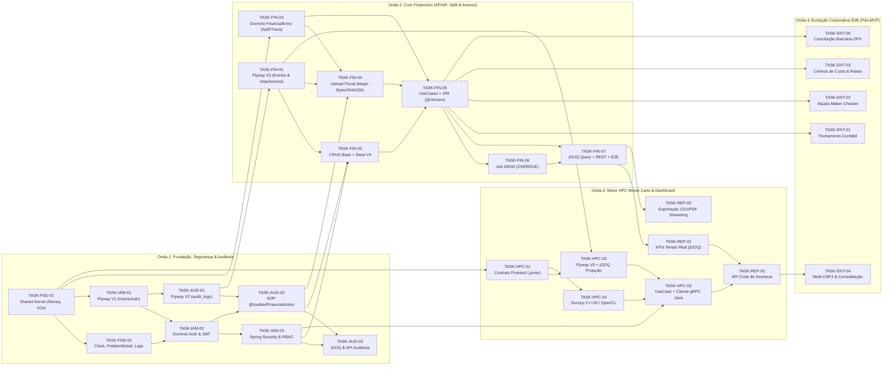

# Desdobramento de Tarefas Técnicas por Domínio de Negócio (Backlog Técnico Estruturado)

- **Projeto:** Sistema Integrado de Gestão Financeira Corporativa (`com.emanudev.gestaofinanceira`)
- **Stack Tecnológica:** `Java 25`, `Spring Boot 4.1.1`, `Spring WebMVC`, `Spring Security (JWT/RBAC)`, `gRPC / Protocol Buffers`, `Spring Data JPA / Hibernate`, `jOOQ`, `Flyway`, `PostgreSQL 18`, `C++20 / OpenCL (HPC)`, `OpenTelemetry + Micrometer + Grafana LGTM`, `Testcontainers`, `GraalVM Native Image`
- **Documentos Base:** [PRD_CRITICAL_ANALYSIS.md](./PRD_CRITICAL_ANALYSIS.md), [HEXAGONAL_ARCHITECTURE.md](./HEXAGONAL_ARCHITECTURE.md), [DATABASE_MIGRATIONS.md](./DATABASE_MIGRATIONS.md), [STRUCTURED_LOGGING.md](./STRUCTURED_LOGGING.md) e [TESTING_STRATEGY.md](./TESTING_STRATEGY.md)

---

## Sumário

1. [Visão Geral da Decomposição em Contextos Delimitados (Bounded Contexts)](#1-visão-geral-da-decomposição-em-contextos-delimitados-bounded-contexts)
2. [Fundação & Infraestrutura Transversal (`shared` / `config`)](#2-fundação--infraestrutura-transversal-shared--config)
3. [Domínio 1: Identidade, Controle de Acesso e Governança (`identity` / `auth`)](#3-domínio-1-identidade-controle-de-acesso-e-governança-identity--auth)
4. [Domínio 2: Compliance e Trilha de Auditoria Imutável (`audit`)](#4-domínio-2-compliance-e-trilha-de-auditoria-imutável-audit)
5. [Domínio 3: Cadastros Base e Operação Financeira — Contas a Pagar e Receber (`ledger` / `payable_receivable` / `attachment`)](#5-domínio-3-cadastros-base-e-operação-financeira--contas-a-pagar-e-receber-ledger--payable_receivable--attachment)
6. [Domínio 4: Simulação Estocástica de Risco de Caixa — Motor de Monte Carlo HPC (`simulation` / `hpc-engine`)](#6-domínio-4-simulação-estocástica-de-risco-de-caixa--motor-de-monte-carlo-hpc-simulation--hpc-engine)
7. [Domínio 5: Dashboard Executivo, Cone de Incerteza e Exportação de Relatórios (`reporting` / `dashboard`)](#7-domínio-5-dashboard-executivo-cone-de-incerteza-e-exportação-de-relatórios-reporting--dashboard)
8. [Domínio 6: Backlog Evolutivo Corporativo / Pós-MVP B2B (`enterprise`)](#8-domínio-6-backlog-evolutivo-corporativo--pós-mvp-b2b-enterprise)
9. [Grafo de Dependências e Ordem Recomendada de Execução (Roadmap em Ondas)](#9-grafo-de-dependências-e-ordem-recomendada-de-execução-roadmap-em-ondas)
10. [Matriz de Rastreabilidade (Regras do PRD e Gaps $\times$ Tasks Técnicas)](#10-matriz-de-rastreabilidade-regras-do-prd-e-gaps--tasks-técnicas)

---

## 1. Visão Geral da Decomposição em Contextos Delimitados (Bounded Contexts)

Seguindo as diretrizes de [HEXAGONAL_ARCHITECTURE.md](./HEXAGONAL_ARCHITECTURE.md) (*package-by-feature* no primeiro nível e separação estrita entre `domain`, `application` e `adapter` onde há invariantes ricas de negócio, combinada com CQRS leve via JPA para comandos e jOOQ para consultas analíticas), o sistema é particionado nos seguintes módulos/contextos:

```text
com.emanudev.gestaofinanceira
├── GestaoFinanceiraApplication.java
├── shared/                              # Fundação transversal e Kernel Compartilhado
│   ├── domain/                          # Money, CurrencyCode, Percentage, DateRange, PageQuery, PagedResult, DomainException
│   ├── application/                     # Clock provider, IdempotencyPort, RequestContextPort
│   ├── adapter/in/web/                  # GlobalExceptionHandler (@RestControllerAdvice -> ProblemDetail RFC 9457)
│   └── config/                          # ClockConfig, ObservabilityConfig, VirtualThreadsConfig, JacksonConfig
├── identity/                            # Domínio 1: Autenticação JWT, Usuários e Governança RBAC
│   ├── domain/                          # User, Role (ADMIN, ANALISTA, AUDITOR), UserStatus
│   ├── application/                     # AuthenticateUserUseCase, RefreshTokenUseCase, TokenProviderPort
│   └── adapter/
│       ├── in/web/                      # AuthController, JwtAuthenticationFilter, SecurityConfig
│       └── out/persistence/             # UserPersistenceAdapter, RefreshTokenPersistenceAdapter
├── audit/                               # Domínio 2: Compliance e Trilha de Auditoria Imutável (RN01.1, RN01.2)
│   ├── domain/                          # AuditLogEntry, AuditAction, ActorContext, StateSnapshot
│   ├── application/                     # @AuditedFinancialAction, RecordAuditLogUseCase, AuditQueryPort
│   └── adapter/
│       ├── in/aop/                      # FinancialAuditAspect (captura snapshots antes/depois na mesma transação)
│       ├── in/web/                      # AuditLogController (restrito a ADMIN e AUDITOR)
│       └── out/persistence/             # AuditPersistenceAdapter (JPA append-only), JooqAuditQueryAdapter
├── reference/                           # Domínio 3A: Cadastros Base Enxutos (HEX-13: CRUD direto / CQRS leve)
│   ├── account/                         # FinancialAccount (Conta Bancária/Caixa + Saldo Inicial)
│   ├── category/                        # Category (Natureza Fixa/Variável + Flag Fiscal TAX para RN02.4)
│   └── counterparty/                    # Counterparty (Fornecedor/Cliente + Documento CPF/CNPJ mascarado)
├── entry/                               # Domínio 3B: Operação Financeira - Contas a Pagar/Receber e Anexos (RN02.1 a RN02.4)
│   ├── domain/                          # FinancialEntry (Agregado Rico), EntryType, EntryStatus, SettlementDetails, FiscalAttachment
│   ├── application/                     # CreateEntryUseCase, SettleEntryUseCase (Integral + Split RN02.3), CancelEntryUseCase (Soft Delete RN01.1), UploadAttachmentUseCase (RN02.4), MarkOverdueEntriesUseCase (RN02.2)
│   └── adapter/
│       ├── in/web/                      # FinancialEntryController, AttachmentController
│       ├── in/scheduler/                # OverdueTransitionScheduler (00h00 America/Sao_Paulo + Startup)
│       └── out/
│           ├── persistence/             # FinancialEntryPersistenceAdapter (JPA + @Version), JooqEntryQueryAdapter
│           └── storage/                 # LocalOrS3AttachmentStorageAdapter (Magic Bytes + SHA-256)
├── simulation/                          # Domínio 4: Simulação Estocástica de Risco - Motor HPC (RN03.1 a RN03.3)
│   ├── domain/                          # StressScenarioParams, SimulationHorizon, RiskSimulationResult, DailyPercentileBand
│   ├── application/                     # RunRiskSimulationUseCase (fora de @Transactional), RiskSimulationEnginePort, CashFlowProjectionQueryPort
│   └── adapter/
│       ├── in/web/                      # SimulationController (restrito a ADMIN/GESTOR)
│       └── out/
│           ├── grpc/                    # GrpcRiskSimulationAdapter (Protobuf sint64 cents, Deadline, Semaphore)
│           └── persistence/             # JooqCashFlowProjectionAdapter, SimulationRunPersistenceAdapter
└── reporting/                           # Domínio 5: Dashboard Executivo, Cone de Incerteza e Exportação (RN04.1 a RN04.3)
    ├── application/                     # GetExecutiveKpisQuery, GetUncertaintyConeQuery, ExportEntriesReportUseCase
    └── adapter/
        ├── in/web/                      # DashboardController, ReportExportController (Streaming CSV/PDF)
        └── out/
            ├── persistence/             # JooqDashboardQueryAdapter (KPIs < 100ms e Série Histórica)
            └── export/                  # CsvStreamingExporter, PdfReportExporter (GraalVM-ready)
```

---

## 2. Fundação & Infraestrutura Transversal (`shared` / `config`)

Camada base que estabelece o Kernel Compartilhado (`shared.domain`), o determinismo temporal, o tratamento padronizado de erros HTTP/gRPC e a instrumentação de observabilidade exigida por todos os domínios.

---

### `TASK-FND-01`: Objetos de Valor do Kernel Compartilhado (`Money`, `Percentage`, `DateRange` e Paginação)

- **Objetivo e Escopo Técnico:**
  - Criar os objetos de valor ubíquos e imutáveis em `com.emanudev.gestaofinanceira.shared.domain` utilizando Java 25 puro (sem dependências de Spring, JPA ou Jackson — regra `HEX-01`).
  - Resolver `GAP-FIN-04` garantindo escala monetária fixa (`2` casas decimais), arredondamento bancário `RoundingMode.HALF_EVEN` (ABNT NBR 5891), moeda ISO-4217 (`BRL` padrão) e conversão exata para centavos inteiros (`long toCents()` / `Money.ofCents(long)`), que será usada no contrato gRPC com o motor C++20.
- **Entregáveis e Contratos:**
  - `Money(BigDecimal amount, String currency)`: `record` validando não-nulidade, normalizando escala `2` com `HALF_EVEN`, métodos `add`, `subtract`, `multiply`, `divide`, `isPositive`, `isZero`, `isGreaterThan`, `isLessThan`, `toCents()`.
  - `Percentage(BigDecimal value)`: `record` para taxas de inadimplência e choques de custos (`NUMERIC(7, 4)`), com conversão para fração decimal `[0.0, 1.0]`.
  - `DateRange(LocalDate startDate, LocalDate endDate)`: validação de `startDate <= endDate`.
  - `PageQuery(int page, int size)` (com limite máximo `size <= 100` — `GAP-REP-01`) e `PagedResult<T>(List<T> items, long totalElements, int page, int size, int totalPages)` para evitar vazamento de `Pageable` do Spring Data nas portas (`HEX-07`).
  - Hierarquia base de exceções de negócio: `DomainException`, `BusinessRuleViolationException`, `ResourceNotFoundException`, `ConcurrencyConflictException`.
- **Dependências:** Nenhuma (Task zero do projeto).
- **Critérios de Pronto (DoD) e Testes Exigidos:**
  - `MoneyTest`, `PercentageTest`, `DateRangeTest` (Camada 1 — Unitários puros com `@ParameterizedTest` e `@CsvSource`, executando em `< 5ms`, validando dízimas periódicas, valores negativos, zero, `0.01`, conversão `toCents()` e `assertThat(actual).isEqualByComparingTo(...)` conforme `QA-03`).

---

### `TASK-FND-02`: Configuração de Relógio Determinístico (`Clock`), Tratamento Global de Erros (`ProblemDetail` RFC 9457) e Logs Estruturados

- **Objetivo e Escopo Técnico:**
  - Configurar `java.time.Clock` (fuso operacional `America/Sao_Paulo` para corte diário de vencimentos `GAP-STA-04` e `UTC` para carimbos `Instant`) em `shared.config`.
  - Implementar o `@RestControllerAdvice` global (`GlobalExceptionHandler`) em `shared.adapter.in.web` traduzindo exceções de domínio, erros de validação (`MethodArgumentNotValidException`), conflitos de lock otimista (`ObjectOptimisticLockingFailureException` $\rightarrow$ `409 Conflict` `GAP-CON-01`) e violações de idempotência para `ProblemDetail` (RFC 9457) com `trace_id` anexo.
  - Configurar o Structured Logging JSON no `application.yaml` (`spring.logging.structured.format.console=ecs`) e métricas customizadas Micrometer/OpenTelemetry (`STRUCTURED_LOGGING.md`).
- **Entregáveis e Contratos:**
  - `TimeConfig.java` expondo `@Bean Clock businessClock()`.
  - `GlobalExceptionHandler.java` mapeando:
    - `ResourceNotFoundException` $\rightarrow$ `HTTP 404 Not Found`
    - `BusinessRuleViolationException` $\rightarrow$ `HTTP 422 Unprocessable Entity` (incluindo código de erro estruturado `error_code`, ex.: `MISSING_FISCAL_ATTACHMENT`, `IMMUTABLE_ENTRY_STATUS`)
    - `ConcurrencyConflictException` / `OptimisticLockingFailureException` $\rightarrow$ `HTTP 409 Conflict`
    - `AccessDeniedException` $\rightarrow$ `HTTP 403 Forbidden`
  - Uso estrito da API fluente SLF4J 2 (`log.atWarn().addKeyValue(...).log(...)`) sem *Log-and-Throw* (`LOG-03`).
- **Dependências:** `TASK-FND-01`.
- **Critérios de Pronto (DoD) e Testes Exigidos:**
  - `GlobalExceptionHandlerIntegrationTest` (`@WebMvcTest`) validando o contrato JSON `application/problem+json` para todos os códigos de status (`400`, `403`, `404`, `409`, `422`, `500`) e confirmando que stack traces nunca vazam no corpo HTTP.

---

## 3. Domínio 1: Identidade, Controle de Acesso e Governança (`identity` / `auth`)

Implementa a matriz de governança RBAC do PRD (Seção 2), o ciclo de vida seguro de tokens JWT (`GAP-SEC-01`) e a propagação de contexto do ator autenticado (usuário + IP) para a camada de auditoria.

---

### `TASK-IAM-01`: Migração Flyway de Usuários, Perfis RBAC e Refresh Tokens (`V1`)

- **Objetivo e Escopo Técnico:**
  - Criar a primeira migração versionada em `src/main/resources/db/migration/V1__create_users_and_auth_tables.sql` seguindo todas as regras de `DATABASE_MIGRATIONS.md`.
- **Entregáveis e Contratos:**
  - Tabela `users`:
    - `id UUID NOT NULL DEFAULT uuidv7()` (`pk_users`)
    - `full_name VARCHAR(150) NOT NULL`
    - `email VARCHAR(150) NOT NULL` (`uq_users_email`)
    - `password_hash VARCHAR(255) NOT NULL`
    - `role VARCHAR(30) NOT NULL` (`ck_users_role CHECK (role IN ('ADMIN', 'ANALISTA', 'AUDITOR'))` — nota: `ADMIN` representa o perfil Administrador/Gestor Financeiro do PRD)
    - `status VARCHAR(20) NOT NULL DEFAULT 'ACTIVE'` (`ck_users_status CHECK (status IN ('ACTIVE', 'BLOCKED', 'INACTIVE'))`)
    - `version BIGINT NOT NULL DEFAULT 0`
    - `created_at TIMESTAMPTZ NOT NULL DEFAULT CURRENT_TIMESTAMP`
    - `updated_at TIMESTAMPTZ NOT NULL DEFAULT CURRENT_TIMESTAMP`
  - Tabela `refresh_tokens`:
    - `id UUID NOT NULL DEFAULT uuidv7()` (`pk_refresh_tokens`)
    - `user_id UUID NOT NULL` (`fk_refresh_tokens_user_id REFERENCES users (id) ON DELETE RESTRICT`)
    - `token_hash VARCHAR(64) NOT NULL` (`uq_refresh_tokens_hash`)
    - `expires_at TIMESTAMPTZ NOT NULL`
    - `revoked_at TIMESTAMPTZ NULL`
    - `created_at TIMESTAMPTZ NOT NULL DEFAULT CURRENT_TIMESTAMP`
    - Índice explícito `idx_refresh_tokens_user_id ON refresh_tokens (user_id)` (`MIG-03`).
- **Dependências:** `TASK-FND-01`.
- **Critérios de Pronto (DoD) e Testes Exigidos:**
  - Teste de integração `@DataJpaTest` + `@Import(TestcontainersConfiguration.class)` validando aplicação limpa da migração `V1` no PostgreSQL 18 real e respeito às `CHECK` e `UNIQUE` constraints (`MIG-08`).

---

### `TASK-IAM-02`: Domínio, Casos de Uso de Autenticação JWT e Contexto de Requisição (`RequestActorContext`)

- **Objetivo e Escopo Técnico:**
  - Implementar o domínio e casos de uso de autenticação em `identity.domain` e `identity.application`, além da porta de contexto do ator (`ActorContextPort`) para desacoplar os casos de uso e a auditoria de `HttpServletRequest` e `SecurityContextHolder`.
- **Entregáveis e Contratos:**
  - `Role` enum (`ADMIN`, `ANALISTA`, `AUDITOR`) com métodos de permissão semânticos (`canDeleteLogically()`, `canRunRiskSimulation()`, `canWriteEntries()`, `canReadAuditLogs()`).
  - `ActorContext(UUID userId, String userName, Role role, String ipAddress, String actorType)` (`USER` vs. `SYSTEM` para jobs agendados — `GAP-AUD-01`).
  - `AuthenticateUserUseCase`, `RefreshTokenUseCase`, `LogoutUseCase` e `UserPersistenceAdapter` (`adapter.out.persistence`).
  - Serviço de geração/validação de JWT (`JwtTokenProviderAdapter`) com chave injetada via variável de ambiente (`SEC-02`), Access Token de `15 min` e Refresh Token rotativo com hash SHA-256 (`GAP-SEC-01`).
- **Dependências:** `TASK-IAM-01`, `TASK-FND-02`.
- **Critérios de Pronto (DoD) e Testes Exigidos:**
  - Testes unitários (`AuthenticateUserUseCaseTest`, `RoleTest`) validando matriz de permissões, rejeição de usuário `BLOCKED` e expiração determinística via `Clock.fixed(...)`.
  - Teste de integração `UserPersistenceAdapterIntegrationTest` com PostgreSQL Testcontainers.

---

### `TASK-IAM-03`: Configuração do Spring Security, Filtro JWT/IP e Endpoints de Autenticação (`/api/v1/auth/**`)

- **Objetivo e Escopo Técnico:**
  - Configurar o `SecurityFilterChain` stateless em `identity.adapter.in.web`, o filtro de extração de JWT + IP real (`X-Forwarded-For` seguro / `RemoteAddr`) e o `AuthController`.
  - Atender ao **Critério de Aceite #1 da Banca**: *"Bloqueio total a rotas financeiras sem token válido; impedimento de exclusão de registros pelo perfil Analista"*.
- **Entregáveis e Contratos:**
  - Endpoints REST:
    - `POST /api/v1/auth/login` $\rightarrow$ retorna `TokenResponse(String accessToken, String refreshToken, long expiresIn, UserSummaryDto user)`
    - `POST /api/v1/auth/refresh` $\rightarrow$ rotaciona o refresh token
    - `POST /api/v1/auth/logout` $\rightarrow$ revoga o refresh token
    - `GET /api/v1/users/me` $\rightarrow$ dados do perfil logado
  - Regras de autorização declarativas (`@PreAuthorize` + matchers de rota):
    - `DELETE /api/v1/entries/**` (cancelamento lógico): exclusivo `ROLE_ADMIN`
    - `POST /api/v1/simulations/**`: exclusivo `ROLE_ADMIN`
    - `GET /api/v1/audit-logs/**`: exclusivo `ROLE_ADMIN` e `ROLE_AUDITOR`
    - `POST / PUT / PATCH /api/v1/entries/**`: exclusivo `ROLE_ADMIN` e `ROLE_ANALISTA` (`ROLE_AUDITOR` bloqueado para qualquer mutação).
- **Dependências:** `TASK-IAM-02`.
- **Critérios de Pronto (DoD) e Testes Exigidos:**
  - `AuthControllerIntegrationTest` e `RbacSecurityMatrixIntegrationTest` (`@WebMvcTest` com `@WithMockUser` e tokens JWT reais/expirados/inválidos) provando todas as combinações da Matriz RBAC (`401 Unauthorized` sem token; `403 Forbidden` quando `ANALISTA` tenta deletar ou simular, e quando `AUDITOR` tenta criar ou liquidar conta).

---

## 4. Domínio 2: Compliance e Trilha de Auditoria Imutável (`audit`)

Atende integralmente ao **Módulo 1 do PRD (`RN01.1` e `RN01.2`)**, garantindo imutabilidade no banco de dados (*append-only*) e captura transacional de snapshots Antes/Depois via Spring AOP sem sofrer do bug de cache de 1º nível do Hibernate (Seção 3.2 de `PRD_CRITICAL_ANALYSIS.md`).

---

### `TASK-AUD-01`: Migração Flyway da Tabela Append-Only `audit_logs` com Proteção Trigger (`V2`)

- **Objetivo e Escopo Técnico:**
  - Criar a migração `src/main/resources/db/migration/V2__create_audit_logs_table.sql` com colunas `JSONB` para os snapshots (`GAP-AUD-02`) e trigger no PostgreSQL que proíbe `UPDATE` e `DELETE` na própria tabela de auditoria (`GAP-AUD-01`).
- **Entregáveis e Contratos:**
  - Tabela `audit_logs`:
    - `id UUID NOT NULL DEFAULT uuidv7()` (`pk_audit_logs`)
    - `entity_type VARCHAR(50) NOT NULL` (ex.: `'FINANCIAL_ENTRY'`, `'FINANCIAL_ACCOUNT'`, `'FISCAL_ATTACHMENT'`)
    - `entity_id UUID NOT NULL`
    - `action VARCHAR(40) NOT NULL` (`ck_audit_logs_action CHECK (action IN ('CREATE', 'UPDATE', 'SETTLE', 'PARTIAL_SETTLE_SPLIT', 'CANCEL_SOFT_DELETE', 'AUTO_OVERDUE_TRANSITION', 'UPLOAD_ATTACHMENT'))`)
    - `actor_type VARCHAR(20) NOT NULL` (`'USER'`, `'SYSTEM'`)
    - `user_id UUID NULL` (`fk_audit_logs_user_id REFERENCES users (id) ON DELETE RESTRICT` — `NULL` permitido apenas quando `actor_type = 'SYSTEM'`)
    - `user_name VARCHAR(150) NOT NULL`
    - `user_role VARCHAR(30) NOT NULL`
    - `ip_address VARCHAR(45) NOT NULL`
    - `trace_id VARCHAR(64) NULL` (correlação direta com Grafana Loki/Tempo)
    - `previous_state JSONB NULL` (`NULL` em `CREATE`)
    - `new_state JSONB NOT NULL`
    - `occurred_at TIMESTAMPTZ NOT NULL DEFAULT CURRENT_TIMESTAMP`
  - Trigger PL/pgSQL `trg_prevent_audit_logs_mutation` lançando exceção no PostgreSQL caso qualquer `UPDATE`, `DELETE` ou `TRUNCATE` seja tentado em `audit_logs`.
  - Índices: `idx_audit_logs_entity (entity_type, entity_id, occurred_at DESC)`, `idx_audit_logs_occurred_at (occurred_at DESC)` e `idx_audit_logs_user_id (user_id)`.
- **Dependências:** `TASK-IAM-01`.
- **Critérios de Pronto (DoD) e Testes Exigidos:**
  - Teste de integração com PostgreSQL Testcontainers provando que: (1) inserções funcionam com `JSONB`; (2) qualquer tentativa de `UPDATE` ou `DELETE` em `audit_logs` falha no banco de dados.

---

### `TASK-AUD-02`: Domínio de Auditoria, Interceptor AOP `@AuditedFinancialAction` e Persistência Transacional

- **Objetivo e Escopo Técnico:**
  - Implementar o mecanismo de auditoria automática exigido pela `RN01.2` em `audit.domain`, `audit.application`, `audit.adapter.in.aop` e `audit.adapter.out.persistence`.
  - Evitar a armadilha do cache de 1º nível do Hibernate (Seção 3.2 da Análise Crítica): a captura do `previous_state` ocorre sobre o **snapshot imutável da entidade de domínio** antes da mutação, e a gravação do log ocorre na **mesma transação `@Transactional`** da operação financeira (se o log falhar, a operação inteira sofre rollback).
- **Entregáveis e Contratos:**
  - `AuditLogEntry` (record de domínio), `AuditableTransition<T>(String entityType, UUID entityId, AuditAction action, Object previousSnapshot, Object newSnapshot, T result)`.
  - Anotação `@AuditedFinancialAction(action = ..., entityType = ...)` + aspecto `FinancialAuditAspect` e porta `AuditTrailPort`.
  - `AuditPersistenceAdapter` (JPA/JDBC *package-private*) serializando os snapshots de domínio em `JSONB` (com mascaramento de campos sensíveis conforme `LOG-02`).
- **Dependências:** `TASK-AUD-01`, `TASK-IAM-02`.
- **Critérios de Pronto (DoD) e Testes Exigidos:**
  - Teste unitário `FinancialAuditAspectTest` validando captura de `previous_state` $\neq$ `new_state`, preenchimento de `userId`, `userName`, `ipAddress` e `SYSTEM_SCHEDULER`.
  - Teste de integração `AuditPersistenceAdapterIntegrationTest` verificando persistência do `JSONB` e rollback conjunto caso a transação principal falhe.

---

### `TASK-AUD-03`: Consulta Paginada de Logs de Auditoria via jOOQ e Endpoint REST para Auditores (`RN01.2`)

- **Objetivo e Escopo Técnico:**
  - Implementar o lado de leitura CQRS dos logs de auditoria usando **jOOQ (`DSLContext`)** em `audit.adapter.out.persistence.JooqAuditQueryAdapter` e expor a API REST para o perfil `AUDITOR` e `ADMIN`.
- **Entregáveis e Contratos:**
  - `AuditLogFilter(Optional<String> entityType, Optional<UUID> entityId, Optional<UUID> userId, Optional<AuditAction> action, Optional<Instant> from, Optional<Instant> to, PageQuery pageQuery)`.
  - Endpoints REST em `AuditLogController`:
    - `GET /api/v1/audit-logs` (paginado, filtros combinados)
    - `GET /api/v1/entries/{entryId}/audit-history` (linha do tempo completa de alterações de um lançamento específico, incluindo o antes/depois em JSON).
- **Dependências:** `TASK-AUD-02`, `TASK-IAM-03`.
- **Critérios de Pronto (DoD) e Testes Exigidos:**
  - `JooqAuditQueryAdapterIntegrationTest` (`@JooqTest` + `TestcontainersConfiguration`) validando filtros combinados e ordenação cronológica reversa.
  - `AuditLogControllerIntegrationTest` (`@WebMvcTest`) validando acesso permitido a `AUDITOR`/`ADMIN` e negado (`403`) a `ANALISTA`.

---

## 5. Domínio 3: Cadastros Base e Operação Financeira — Contas a Pagar e Receber (`ledger` / `payable_receivable` / `attachment`)

Coração transacional do sistema. Implementa os cadastros auxiliares enxutos (`GAP-FIN-02`, Seção 3.6) e todas as regras do **Módulo 2 (`RN02.1`, `RN02.2`, `RN02.3`, `RN02.4`)** e **`RN01.1` (Soft Delete)** com domínio rico, lock otimista (`@Version`) e chaves de idempotência.

---

### `TASK-FIN-01`: Migração Flyway de Contas Financeiras, Categorias, Contrapartes, Lançamentos e Anexos Fiscais (`V3`)

- **Objetivo e Escopo Técnico:**
  - Criar `src/main/resources/db/migration/V3__create_financial_operations_tables.sql` contemplando a estrutura relacional completa para Contas a Pagar/Receber, hierarquia de *split* (`parent_entry_id`) e metadados de anexos fiscais.
- **Entregáveis e Contratos:**
  - Tabela `financial_accounts` (`GAP-FIN-02` — carteira/caixa interno puramente contábil para lastro do Saldo Consolidado; **sem integração com contas bancárias reais ou dinheiro real no MVP**):
    - `id UUID NOT NULL DEFAULT uuidv7()` (`pk_financial_accounts`), `name VARCHAR(120) NOT NULL`, `initial_balance NUMERIC(19, 2) NOT NULL DEFAULT 0.00`, `currency VARCHAR(3) NOT NULL DEFAULT 'BRL'`, `status VARCHAR(20) NOT NULL DEFAULT 'ACTIVE'`, `version BIGINT NOT NULL DEFAULT 0`, `created_at TIMESTAMPTZ`, `updated_at TIMESTAMPTZ`.
  - Tabela `categories` (`RN02.1`, `RN02.4`, `GAP-HPC-01`):
    - `id UUID NOT NULL DEFAULT uuidv7()` (`pk_categories`), `code VARCHAR(30) NOT NULL` (`uq_categories_code`), `name VARCHAR(100) NOT NULL`, `category_type VARCHAR(20) NOT NULL` (`'REVENUE'`, `'EXPENSE'`), `cost_behavior VARCHAR(20) NOT NULL` (`'FIXED'`, `'VARIABLE'` — usado pelo Monte Carlo na `RN03.1`), `requires_fiscal_attachment BOOLEAN NOT NULL DEFAULT false` (`true` para categoria `"Impostos"` / `TAX` — `RN02.4`), `active BOOLEAN NOT NULL DEFAULT true`.
  - Tabela `counterparties` (`RN02.1` — Fornecedores/Clientes):
    - `id UUID NOT NULL DEFAULT uuidv7()` (`pk_counterparties`), `legal_name VARCHAR(150) NOT NULL`, `trade_name VARCHAR(150) NULL`, `document_number VARCHAR(20) NOT NULL` (`uq_counterparties_document`), `counterparty_type VARCHAR(20) NOT NULL` (`'SUPPLIER'`, `'CUSTOMER'`, `'BOTH'`, `'TAX_AUTHORITY'`), `active BOOLEAN NOT NULL DEFAULT true`, `created_at TIMESTAMPTZ`.
  - Tabela `financial_entries` (`RN02.1`, `RN02.2`, `RN02.3`):
    - `id UUID NOT NULL DEFAULT uuidv7()` (`pk_financial_entries`)
    - `idempotency_key VARCHAR(64) NOT NULL` (`uq_financial_entries_idempotency` — `GAP-CON-02`)
    - `parent_entry_id UUID NULL` (`fk_financial_entries_parent_id REFERENCES financial_entries (id) ON DELETE RESTRICT` — rastreia o *split* da `RN02.3`)
    - `root_entry_id UUID NOT NULL` (aponta para o próprio `id` na conta raiz ou para a raiz original em *splits* sucessivos, impedindo burlar a trava de `R\$ 5.000,00` da `RN02.4` — `GAP-STA-03`)
    - `entry_type VARCHAR(15) NOT NULL` (`ck_financial_entries_type CHECK (entry_type IN ('PAYABLE', 'RECEIVABLE'))` — `GAP-FIN-01`)
    - `description VARCHAR(255) NOT NULL`
    - `category_id UUID NOT NULL` (`fk_financial_entries_category_id REFERENCES categories (id) ON DELETE RESTRICT`)
    - `counterparty_id UUID NOT NULL` (`fk_financial_entries_counterparty_id REFERENCES counterparties (id) ON DELETE RESTRICT`)
    - `financial_account_id UUID NULL` (`fk_financial_entries_account_id REFERENCES financial_accounts (id) ON DELETE RESTRICT`)
    - `currency VARCHAR(3) NOT NULL DEFAULT 'BRL'` (`ck_financial_entries_currency CHECK (char_length(currency) = 3)`)
    - `root_original_amount NUMERIC(19, 2) NOT NULL` (`> 0`)
    - `original_amount NUMERIC(19, 2) NOT NULL` (`ck_financial_entries_original_amount CHECK (original_amount > 0)`)
    - `principal_settled_amount NUMERIC(19, 2) NULL`
    - `interest_amount NUMERIC(19, 2) NOT NULL DEFAULT 0.00` (`>= 0` — `GAP-FIN-03`)
    - `penalty_amount NUMERIC(19, 2) NOT NULL DEFAULT 0.00` (`>= 0`)
    - `discount_amount NUMERIC(19, 2) NOT NULL DEFAULT 0.00` (`>= 0`)
    - `paid_amount NUMERIC(19, 2) NULL` (`ck_financial_entries_paid_amount CHECK (paid_amount IS NULL OR paid_amount > 0)`)
    - `issue_date DATE NOT NULL`
    - `competence_date DATE NOT NULL` (`GAP-FIN-05`)
    - `due_date DATE NOT NULL` (`ck_financial_entries_due_ge_issue CHECK (due_date >= issue_date)`)
    - `settlement_date DATE NULL`
    - `status VARCHAR(25) NOT NULL` (`ck_financial_entries_status CHECK (status IN ('PENDING', 'OVERDUE', 'PARTIALLY_SETTLED', 'SETTLED', 'CANCELLED'))` — `GAP-STA-01`)
    - `cancellation_reason VARCHAR(255) NULL`
    - `cancelled_at TIMESTAMPTZ NULL`
    - `version BIGINT NOT NULL DEFAULT 0` (`@Version` — `GAP-CON-01`)
    - `created_at TIMESTAMPTZ NOT NULL DEFAULT CURRENT_TIMESTAMP`
    - `updated_at TIMESTAMPTZ NOT NULL DEFAULT CURRENT_TIMESTAMP`
  - Tabela `fiscal_attachments` (`RN02.4`, `GAP-SEC-03`):
    - `id UUID NOT NULL DEFAULT uuidv7()` (`pk_fiscal_attachments`), `entry_id UUID NOT NULL` (`fk_fiscal_attachments_entry_id REFERENCES financial_entries (id) ON DELETE RESTRICT`), `original_file_name VARCHAR(255) NOT NULL`, `content_type VARCHAR(50) NOT NULL` (`ck_fiscal_attachments_mime CHECK (content_type IN ('application/pdf', 'image/jpeg', 'image/png'))`), `file_size_bytes BIGINT NOT NULL` (`CHECK (file_size_bytes > 0 AND file_size_bytes <= 10485760)`), `sha256_hash VARCHAR(64) NOT NULL`, `storage_key VARCHAR(500) NOT NULL`, `uploaded_by UUID NOT NULL` (`REFERENCES users (id) ON DELETE RESTRICT`), `uploaded_at TIMESTAMPTZ NOT NULL DEFAULT CURRENT_TIMESTAMP`.
  - Índices explícitos em todas as FKs (`MIG-03`) e índices parciais (`WHERE status <> 'CANCELLED'`) para consultas de vencimento e dashboard.
- **Dependências:** `TASK-IAM-01`, `TASK-AUD-01`.
- **Critérios de Pronto (DoD) e Testes Exigidos:**
  - Teste de integração validando a migração `V3` no PostgreSQL Testcontainers, testando todas as constraints (`CHECK` de valores positivos, datas, status, tamanho de arquivo e `ON DELETE RESTRICT`).

---

### `TASK-FIN-02`: Cadastros Base Enxutos (`FinancialAccount`, `Category` e `Counterparty`) e Seed Inicial (`V4`)

- **Objetivo e Escopo Técnico:**
  - Seguindo a diretriz `HEX-13` de `HEXAGONAL_ARCHITECTURE.md` (evitar over-engineering em cadastros auxiliares sem invariantes complexas), implementar endpoints CRUD enxutos em `reference.account`, `reference.category` e `reference.counterparty`, além de uma migração `V4__seed_default_categories_and_account.sql` contendo o plano básico de categorias (incluindo `"Impostos"` com `requires_fiscal_attachment = true` e despesas fixas/variáveis) e a Conta Caixa Principal.
- **Entregáveis e Contratos:**
  - Endpoints REST:
    - `GET / POST /api/v1/financial-accounts`
    - `GET / POST /api/v1/categories`
    - `GET / POST /api/v1/counterparties`
  - Toda criação/alteração auditada via `@AuditedFinancialAction`.
- **Dependências:** `TASK-FIN-01`, `TASK-AUD-02`, `TASK-IAM-03`.
- **Critérios de Pronto (DoD) e Testes Exigidos:**
  - Testes de integração de persistência e `@WebMvcTest` para os 3 recursos.

---

### `TASK-FIN-03`: Modelo de Domínio Rico `FinancialEntry` (Máquina de Estados, Liquidação, Split de Baixa Parcial e Trava Fiscal)

- **Objetivo e Escopo Técnico:**
  - Implementar em `entry.domain` (100% Java 25 puro, zero anotações de framework — `HEX-01`, `HEX-05`) o agregado `FinancialEntry` e seus objetos de valor, encapsulando todas as invariantes das regras `RN01.1`, `RN02.1`, `RN02.2`, `RN02.3` e `RN02.4`.
- **Entregáveis e Contratos:**
  - `FinancialEntry.create(...)`:
    - Valida campos obrigatórios (`RN02.1`): descrição não vazia, `originalAmount > 0`, `dueDate >= issueDate`, `categoryId`, `counterpartyId`.
    - Define status inicial determinístico com base no `LocalDate currentDate` recebido por parâmetro (`PENDING` se `dueDate >= currentDate`, ou já `OVERDUE` se `dueDate < currentDate` — `GAP-STA-04`).
  - `FinancialEntry.markOverdue(LocalDate currentDate)` (`RN02.2`):
    - Transiciona `PENDING` $\rightarrow$ `OVERDUE` se `currentDate > dueDate`. Idempotente se já estiver `OVERDUE`; lança exceção de domínio se chamado em `SETTLED`, `PARTIALLY_SETTLED` ou `CANCELLED`.
  - `FinancialEntry.settle(SettlementCommand, boolean categoryRequiresAttachment, int currentAttachmentCount)` (`RN02.2`, `RN02.3`, `RN02.4`):
    - **Validação da Trava Fiscal (`RN02.4` + `GAP-STA-03`):** Se `categoryRequiresAttachment == true` (categoria `"Impostos"`) **OU** `rootOriginalAmount > R$ 5.000,00` (`5000.00`) **OU** `paidAmount > R$ 5.000,00`, exige `currentAttachmentCount > 0`. Caso contrário, lança `MissingFiscalAttachmentException` (`HTTP 422`).
    - **Liquidação Integral (`RN02.2` + `GAP-FIN-03`):** Quando `principalSettled == originalAmount`, calcula `paidAmount = principalSettled + interest + penalty - discount`, exige `settlementDate != null` e transiciona o status para `SETTLED`. Retorna `SettlementOutcome.FullySettled(this)`.
    - **Baixa Parcial com Split Automático (`RN02.3` + `GAP-STA-02`):** Quando `0 < principalSettled < originalAmount`, marca a transação original como `PARTIALLY_SETTLED` (registrando `principalSettledAmount` e `paidAmount` efetivamente pagos nela) e **instancia automaticamente a nova `FinancialEntry` filha** com:
      - `parentEntryId = this.id`
      - `rootEntryId = this.rootEntryId`
      - `rootOriginalAmount = this.rootOriginalAmount`
      - `originalAmount = this.originalAmount.subtract(principalSettled)` (saldo remanescente exato, ex.: `R$ 10.000,00 - R$ 4.000,00 = R$ 6.000,00`)
      - `dueDate = newDueDateForRemainder.orElse(this.dueDate)`
      - `status = (childDueDate < currentDate) ? OVERDUE : PENDING`
      - Retorna `SettlementOutcome.PartiallySettledWithSplit(this, childEntry)`.
  - `FinancialEntry.cancel(String reason, Instant cancelledAt)` (`RN01.1` — *Soft Delete*):
    - Altera status para `CANCELLED` exigindo motivo não vazio. Proíbe cancelar lançamentos já `SETTLED` ou `PARTIALLY_SETTLED` sem estorno (`GAP-STA-05`).
- **Dependências:** `TASK-FND-01`.
- **Critérios de Pronto (DoD) e Testes Exigidos:**
  - `FinancialEntryTest` (Camada 1 — Unitário puro JUnit 5 + AssertJ, zero Spring, `< 10ms`) cobrindo:
    - Criação `PENDING` vs. `OVERDUE` retroativo;
    - Liquidação integral com juros, multa e desconto;
    - Baixa parcial (`R$ 10.000,00` pago `R$ 4.000,00` $\rightarrow$ pai `PARTIALLY_SETTLED` com `4.000,00` e filho `PENDING` com `6.000,00`, `parentEntryId` vinculado e `rootOriginalAmount` preservado);
    - Bloqueio de liquidação sem anexo quando categoria é `"Impostos"` (mesmo para `R$ 100,00`), quando valor é `R$ 5.000,01` ou quando é a 2ª parcela de *split* de uma conta raiz de `R$ 8.000,00` (`GAP-STA-03`);
    - Cancelamento lógico (`RN01.1`) e proibição de mutar registro já `SETTLED` ou `CANCELLED`.

---

### `TASK-FIN-04`: Upload Seguro e Validação de Anexos Fiscais (`RN02.4` — `PDF`, `JPG`, `PNG` + Magic Bytes + SHA-256)

- **Objetivo e Escopo Técnico:**
  - Implementar o fluxo de upload, armazenamento seguro e download de comprovantes fiscais em `entry.application` e `entry.adapter.out.storage` (`GAP-SEC-03`).
- **Entregáveis e Contratos:**
  - `FiscalAttachmentValidator`: inspeciona os **Magic Bytes** reais do stream (`%PDF-` para PDF, `\xFF\xD8\xFF` para JPG, `\x89PNG\r\n\x1a\n` para PNG), rejeitando arquivos forjados, vazios ou maiores que `10 MB`. Calcula o hash `SHA-256` do conteúdo.
  - Porta `AttachmentStoragePort` e adaptador `FileSystemAttachmentStorageAdapter` (com diretório configurável via propriedades e seguro contra *Path Traversal*).
  - Casos de Uso: `UploadFiscalAttachmentUseCase` (auditado via `@AuditedFinancialAction`) e `DownloadFiscalAttachmentUseCase`.
  - Endpoints REST:
    - `POST /api/v1/entries/{entryId}/attachments` (`multipart/form-data` — permitido para `ANALISTA` e `ADMIN`)
    - `GET /api/v1/entries/{entryId}/attachments` (lista metadados e hashes SHA-256)
    - `GET /api/v1/entries/{entryId}/attachments/{attachmentId}/content` (download do arquivo — permitido para `ANALISTA`, `ADMIN` e `AUDITOR`).
- **Dependências:** `TASK-FIN-01`, `TASK-FIN-03`, `TASK-AUD-02`.
- **Critérios de Pronto (DoD) e Testes Exigidos:**
  - Teste unitário `FiscalAttachmentValidatorTest` testando headers binários válidos (`PDF`, `JPG`, `PNG`) e rejeitando executável `.exe` ou texto renomeado para `.pdf`.
  - Teste de integração `AttachmentControllerIntegrationTest` (`MockMvc` `multipart`).

---

### `TASK-FIN-05`: Casos de Uso Transacionais (`Create`, `Settle`, `Cancel`) e Adaptador de Persistência JPA com Lock Otimista

- **Objetivo e Escopo Técnico:**
  - Implementar os casos de uso em `entry.application` e o adaptador `FinancialEntryPersistenceAdapter` (*package-private*) em `entry.adapter.out.persistence`.
  - Integrar com `@AuditedFinancialAction` para que toda criação, liquidação, baixa parcial (*split*) e cancelamento lógico gere automaticamente o registro em `audit_logs` com `previous_state` e `new_state` na mesma transação.
  - Garantir que no *split* (`RN02.3`), os anexos fiscais já vinculados à conta pai também sejam referenciados/reconhecidos na conta filha.
- **Entregáveis e Contratos:**
  - `CreateFinancialEntryUseCase` (verifica `Idempotency-Key` `GAP-CON-02`).
  - `SettleFinancialEntryUseCase` (carrega lançamento + categoria + contagem de anexos na árvore `root_entry_id`, executa `entry.settle(...)`, salva lançamento atualizado e eventual lançamento filho gerado pelo *split*).
  - `CancelFinancialEntryUseCase` (exclusivo para `ADMIN` — executa `entry.cancel(...)` e persiste `status = 'CANCELLED'`, sem jamais executar `DELETE` físico no banco — `RN01.1`).
  - `FinancialEntryJpaEntity` com `@Version private long version;` para proteção contra baixas concorrentes (`GAP-CON-01`).
- **Dependências:** `TASK-FIN-02`, `TASK-FIN-03`, `TASK-FIN-04`.
- **Critérios de Pronto (DoD) e Testes Exigidos:**
  - Testes unitários dos casos de uso (`CreateFinancialEntryUseCaseTest`, `SettleFinancialEntryUseCaseTest`, `CancelFinancialEntryUseCaseTest`) com *In-Memory Fakes* (`QA-01`, `QA-05`).
  - Teste de integração `FinancialEntryPersistenceAdapterIntegrationTest` (`@DataJpaTest` + `TestcontainersConfiguration`) incluindo teste explícito de **Concorrência / Lock Otimista** (duas threads tentando liquidar a mesma conta simultaneamente $\rightarrow$ exatamente uma sucede e a outra lança `ObjectOptimisticLockingFailureException`).

---

### `TASK-FIN-06`: Rotina Automática Diária (`00h00`) de Transição para `OVERDUE` (`RN02.2`)

- **Objetivo e Escopo Técnico:**
  - Implementar o caso de uso `MarkOverdueEntriesUseCase` e o adaptador de entrada agendado `OverdueTransitionScheduler` (`@Scheduled(cron = "0 0 0 * * *", zone = "America/Sao_Paulo")` + execução no `ApplicationReadyEvent` caso o servidor estivesse desligado à meia-noite — `GAP-STA-04`).
- **Entregáveis e Contratos:**
  - Busca todos os lançamentos com `status = 'PENDING'` e `due_date < currentDate(America/Sao_Paulo)`, transiciona para `OVERDUE` e registra a trilha de auditoria com `actor_type = 'SYSTEM'`, `user_name = 'SYSTEM_SCHEDULER'` (`GAP-AUD-01`).
  - Emite um único log estruturado consolidado ao final do lote com `processed_count` e `duration_ms` (respeitando `LOG-06` — sem logar dentro de laço `for`).
- **Dependências:** `TASK-FIN-05`.
- **Critérios de Pronto (DoD) e Testes Exigidos:**
  - Teste unitário e de integração com `Clock.fixed(...)` comprovando que títulos vencidos mudam de `PENDING` para `OVERDUE` e geram `audit_logs` do ator `SYSTEM`.

---

### `TASK-FIN-07`: Consulta Avançada Paginada via jOOQ e Controller REST de Lançamentos Financeiros

- **Objetivo e Escopo Técnico:**
  - Implementar `JooqFinancialEntryQueryAdapter` para listagem rápida com múltiplos filtros (status, tipo `PAYABLE`/`RECEIVABLE`, intervalo de vencimento/competência/pagamento, categoria, contraparte, faixa de valor, busca textual) e o `FinancialEntryController` em `entry.adapter.in.web`.
- **Entregáveis e Contratos:**
  - Endpoints REST:
    - `POST /api/v1/entries` (Requer header `Idempotency-Key`; roles: `ADMIN`, `ANALISTA`)
    - `GET /api/v1/entries` (Paginado com `FinancialEntryFilter`; roles: `ADMIN`, `ANALISTA`, `AUDITOR`)
    - `GET /api/v1/entries/{id}` (Detalhes do lançamento + filhos de *split* + anexos; roles: `ADMIN`, `ANALISTA`, `AUDITOR`)
    - `POST /api/v1/entries/{id}/settlements` (Liquidação integral ou baixa parcial com *split*; roles: `ADMIN`, `ANALISTA`)
    - `DELETE /api/v1/entries/{id}` (Cancelamento lógico *Soft Delete* com corpo/param `reason`; role exclusiva: `ADMIN`).
- **Dependências:** `TASK-FIN-05`, `TASK-FIN-06`.
- **Critérios de Pronto (DoD) e Testes Exigidos:**
  - `JooqFinancialEntryQueryAdapterIntegrationTest` (`@JooqTest` + `TestcontainersConfiguration`).
  - `FinancialEntryControllerIntegrationTest` (`@WebMvcTest`) cobrindo todos os endpoints, validações `@Valid` e códigos de erro (`400`, `403`, `404`, `409`, `422`).
  - **Teste E2E Crítico (`FinancialEntryLifecycleE2ETest`):** valida o **Critério de Aceite #2 e #4 da Banca** (`Criar Conta -> Tentar Liquidar sem Anexo (422) -> Anexar Nota -> Fazer Baixa Parcial (Split) -> Liquidar Restante -> Cancelar outra Conta (Soft Delete) -> Verificar Logs de Auditoria com Estado Anterior e Novo`).

---

## 6. Domínio 4: Simulação Estocástica de Risco de Caixa — Motor de Monte Carlo HPC (`simulation` / `hpc-engine`)

Implementa o diferencial tecnológico do produto (**Módulo 3: `RN03.1`, `RN03.2` e `RN03.3`**): comunicação de alto desempenho via **gRPC / Protocol Buffers** entre o Backend Core Java 25 e o microsserviço computacional em **C++20 / OpenCL**, simulando $\ge 100.000$ cenários estocásticos e retornando o *Value at Risk* (`VaR P99`), a Mediana (`P50`), a Probabilidade de Ruína e a série temporal para o gráfico "Cone de Incerteza".

---

### `TASK-HPC-01`: Definição do Contrato Protobuf (`risk_simulation.proto`) e Geração de Stubs gRPC

- **Objetivo e Escopo Técnico:**
  - Criar o arquivo `src/main/proto/risk_simulation.proto` (proto3) atendendo às decisões de `GAP-FIN-04` (valores em centavos inteiros `sint64` para evitar ponto flutuante na rede), `GAP-HPC-01` (parâmetros de estresse), `GAP-HPC-02` (retorno tanto das métricas globais quanto da série diária de percentis para o Cone de Incerteza) e `GAP-HPC-03` (`random_seed` opcional e identificação do dispositivo de hardware utilizado).
- **Entregáveis e Contratos:**
  - `service RiskSimulationService { rpc SimulateCashFlowRisk (RiskSimulationRequest) returns (RiskSimulationResponse); }`
  - `RiskSimulationRequest`:
    - `sint64 initial_balance_cents` (Saldo consolidado atual em centavos)
    - `int32 horizon_days` (`30`, `60` ou `90` — `RN03.1`)
    - `int32 num_scenarios` (mínimo `100000` — `RN03.2`)
    - `double expected_default_rate` (Taxa de inadimplência esperada em recebíveis, ex.: `0.10` a `0.30` — `RN03.1`)
    - `double variable_cost_shock_pct` (Oscilação percentual esperada nas despesas variáveis, ex.: `0.15` — `RN03.1`)
    - `optional uint64 random_seed` (Semente para reprodutibilidade determinística em testes e auditorias — `GAP-HPC-03`)
    - `repeated ScheduledCashFlowItem items` (onde cada item possui: `int32 day_offset` de `1..horizon_days`, `sint64 amount_cents`, `CashFlowDirection direction` `[RECEIVABLE, PAYABLE]`, `bool is_variable_cost`).
  - `RiskSimulationResponse`:
    - `sint64 var_99_cents` (Pior cenário `P01` / `VaR 99%` — `RN03.3`)
    - `sint64 median_p50_cents` (Cenário base `P50` — `RN03.3`)
    - `double ruin_probability_pct` (Probabilidade exata de ruína de primeira passagem ou final em `%`, ex.: `14.5` — `RN03.3`)
    - `repeated DailyProjectionBand daily_bands` (Série de `day_offset = 1..H` com `p01_cents`, `p10_cents`, `p50_cents`, `p90_cents`, `p99_cents`, `cumulative_ruin_probability_pct` — alimenta o Cone de Incerteza `RN04.2`)
    - `string execution_device` (ex.: `"OpenCL GPU: NVIDIA RTX..."`, `"OpenCL CPU: PoCL"`, `"C++20 Native SIMD Threads"`)
    - `int64 execution_time_ms`.
- **Dependências:** `TASK-FND-01`.
- **Critérios de Pronto (DoD) e Testes Exigidos:**
  - Compilação limpa via `./mvnw compile` gerando as classes Java Protobuf e o stub `RiskSimulationServiceGrpc` em `target/generated-sources/protobuf`.

---

### `TASK-HPC-02`: Migração Flyway de Histórico de Simulações (`V5`) e Query jOOQ de Extração de Títulos Futuros

- **Objetivo e Escopo Técnico:**
  - Criar `src/main/resources/db/migration/V5__create_simulation_runs_table.sql` para persistir o histórico auditável das simulações disparadas pelo Gestor/Admin.
  - Implementar `JooqCashFlowProjectionAdapter` em `simulation.adapter.out.persistence` que extrai em uma única query indexada (`< 5ms`) o saldo consolidado atual e todos os lançamentos `PENDING` e `OVERDUE` dentro do horizonte de $30/60/90$ dias, junto com a flag `cost_behavior` (`FIXED` vs. `VARIABLE`) da categoria.
- **Entregáveis e Contratos:**
  - Tabela `simulation_runs`: armazena os parâmetros de entrada (`horizon_days`, `num_scenarios`, `expected_default_rate`, `variable_cost_shock_pct`, `initial_balance`), os resultados (`var_99_amount`, `median_p50_amount`, `ruin_probability_pct`, `daily_bands_json JSONB`), metadados de execução (`execution_device`, `execution_time_ms`), `requested_by UUID REFERENCES users(id)` e `created_at TIMESTAMPTZ`.
  - Porta `CashFlowProjectionQueryPort` e implementação jOOQ projetando diretamente em `records` imutáveis (`HEX-09`).
- **Dependências:** `TASK-FIN-01`, `TASK-HPC-01`.
- **Critérios de Pronto (DoD) e Testes Exigidos:**
  - `JooqCashFlowProjectionAdapterIntegrationTest` (`@JooqTest` + `TestcontainersConfiguration`) validando que lançamentos `CANCELLED` e `SETTLED` não entram como fluxo futuro em aberto e que despesas `FIXED` vs. `VARIABLE` são classificadas corretamente.

---

### `TASK-HPC-03`: Caso de Uso `RunRiskSimulationUseCase` (Fora de `@Transactional`) e Adaptador Cliente gRPC com Resiliência

- **Objetivo e Escopo Técnico:**
  - Implementar em `simulation.application` e `simulation.adapter.out.grpc` a orquestração da simulação respeitando rigorosamente a regra `HEX-14` / `PER-01` (Seção 3.3 de `PRD_CRITICAL_ANALYSIS.md`): **nunca manter transação de banco aberta durante a chamada gRPC ao motor HPC**, mantendo a nomenclatura das classes e contratos desacoplada do algoritmo matemático específico (`RiskSimulation` em vez de `MonteCarlo`).
- **Entregáveis e Contratos:**
  - `RunRiskSimulationUseCase`:
    1. Valida parâmetros (`horizonDays` $\in \{30, 60, 90\}$, `defaultRate` $\in [0, 1]$, `costShock` $\in [0, 2]$, `numScenarios >= 100_000`).
    2. Lê os dados via `CashFlowProjectionQueryPort` (conexão JDBC liberada imediatamente).
    3. Invoca `RiskSimulationEnginePort` (chamada gRPC fora de `@Transactional`).
    4. Persiste o resultado em `simulation_runs` em transação curta e registra métricas Micrometer (`finance.simulation.duration`, `finance.simulation.ruin_probability`).
  - `GrpcRiskSimulationAdapter`:
    - Aplica `Semaphore` configurável para limitar simulações simultâneas na GPU/CPU (`CON-01`).
    - Define `withDeadlineAfter(5, TimeUnit.SECONDS)` no stub gRPC e traduz `StatusRuntimeException` (`DEADLINE_EXCEEDED`, `UNAVAILABLE`) para exceções de domínio claras (`RiskEngineUnavailableException` $\rightarrow$ `HTTP 503 Service Unavailable`).
  - `SimulationController` (`POST /api/v1/simulations` e `GET /api/v1/simulations/latest` — restrito a `ROLE_ADMIN`).
- **Dependências:** `TASK-HPC-01`, `TASK-HPC-02`, `TASK-IAM-03`.
- **Critérios de Pronto (DoD) e Testes Exigidos:**
  - `RunRiskSimulationUseCaseTest` (Unitário puro com *Fake* da porta gRPC).
  - `GrpcRiskSimulationAdapterIntegrationTest` utilizando servidor gRPC *in-process* (`spring-boot-starter-grpc-client-test`) testando conversão de centavos `sint64` $\leftrightarrow$ `Money`, timeout/deadline e propagação de erro.

---

### `TASK-HPC-04`: Implementação do Microsserviço HPC em C++20 / OpenCL (`hpc-engine`) e Containerização

- **Objetivo e Escopo Técnico:**
  - Implementar o serviço computacional isolado em `hpc-engine/` utilizando **C++20**, **gRPC C++** e **OpenCL** (com fallback automático para CPU OpenCL / C++20 `std::jthread` + SIMD caso o host não possua GPU dedicada — mitigando o risco crítico `GAP-HPC-03` para avaliação da banca e CI).
- **Entregáveis e Contratos:**
  - Estrutura `hpc-engine/`:
    - `CMakeLists.txt` + `Dockerfile` multi-stage
    - Kernel OpenCL (`src/kernels/monte_carlo_cashflow.cl`) implementando PRNG paralelo *stateless* (*Philox-4x32-10* ou *Xoroshiro128+* parametrizado por `random_seed` + `global_id(0)`):
      - Para cada um dos $N \ge 100.000$ cenários: aplica sorteio de Bernoulli com `expected_default_rate` para postergar recebíveis e aplica perturbação Normal $\mathcal{N}(0, \sigma_{\text{choque}}^2)$ sobre pagáveis variáveis (`GAP-HPC-01`).
      - Avalia a trajetória diária $S_k(t)$ para $t = 1 \dots H$ e marca ocorrência de ruína ($S_k(t) < 0$ — `GAP-HPC-02`).
    - Redução estatística rápida em C++20 (`std::nth_element` / histograma paralelo por dia $t = 1 \dots H$) extraindo `P01 (VaR 99%)`, `P10`, `P50 (Mediana)`, `P90`, `P99` e `Probabilidade de Ruína` exata, retornando o payload compacto (`< 4 KB`) via gRPC.
  - Integração no `docker-compose.yaml` na raiz do projeto para subir o `hpc-engine` junto ao PostgreSQL e à stack Grafana LGTM.
- **Dependências:** `TASK-HPC-01`.
- **Critérios de Pronto (DoD) e Testes Exigidos:**
  - Teste automatizado C++ (CTest) + Teste E2E Java $\leftrightarrow$ C++ validando o **Critério de Aceite #3 da Banca**: execução de 100.000 cenários com `random_seed` fixa retornando `VaR P99`, `Mediana P50`, `Probabilidade de Ruína` e as bandas diárias do horizonte em `< 800ms` (GPU) / `< 2500ms` (CPU).

---

## 7. Domínio 5: Dashboard Executivo, Cone de Incerteza e Exportação de Relatórios (`reporting` / `dashboard`)

Atende integralmente ao **Módulo 4 do PRD (`RN04.1`, `RN04.2` e `RN04.3`)**, utilizando consultas analíticas via **jOOQ** e exportação eficiente em streaming.

---

### `TASK-REP-01`: KPIs em Tempo Real do Cockpit Executivo via jOOQ (`RN04.1`)

- **Objetivo e Escopo Técnico:**
  - Implementar em `reporting.adapter.out.persistence.JooqDashboardQueryAdapter` e `reporting.adapter.in.web.DashboardController` o cálculo em tempo real (`SLO p95 < 100ms` — `GAP-REP-02`) dos 4 indicadores executivos exigidos pela `RN04.1`.
- **Entregáveis e Contratos:**
  - Endpoint `GET /api/v1/dashboard/kpis` (permitido para `ADMIN`, `ANALISTA` e `AUDITOR`) retornando `ExecutiveKpisDto`:
    1. `consolidatedBalance` (`Money`): Soma dos `initial_balance` das contas financeiras ativas $+$ $\sum \text{paid\_amount}$ de recebíveis (`SETTLED` e `PARTIALLY_SETTLED`) $-$ $\sum \text{paid\_amount}$ de pagáveis (`SETTLED` e `PARTIALLY_SETTLED`) (`GAP-FIN-02`, `GAP-STA-02`).
    2. `totalReceivableToday` (`Money`): Soma de `original_amount` dos títulos `RECEIVABLE` com `due_date = today` e `status IN ('PENDING', 'OVERDUE')`.
    3. `totalPayableToday` (`Money`): Soma de `original_amount` dos títulos `PAYABLE` com `due_date = today` e `status IN ('PENDING', 'OVERDUE')`.
    4. `monthlyDelinquencyRatePct` (`BigDecimal`): Fórmula padronizada (`GAP-FIN-06`):
       $$\frac{\sum \text{Recebíveis com } \text{status} = \text{'OVERDUE'} \text{ no mês corrente}}{\sum \text{Todos os Recebíveis não cancelados com vencimento no mês corrente}} \times 100$$
       (retornando `0.00` quando o denominador for zero, evitando divisão por zero).
- **Dependências:** `TASK-FIN-05`, `TASK-FIN-07`.
- **Critérios de Pronto (DoD) e Testes Exigidos:**
  - `JooqDashboardQueryAdapterIntegrationTest` (`@JooqTest` + `TestcontainersConfiguration`) validando matematicamente os 4 KPIs contra uma massa de lançamentos incluindo baixas parciais (*splits*), títulos atrasados, títulos cancelados (que devem ser ignorados) e mês sem recebíveis.

---

### `TASK-REP-02`: Endpoint Composto do Gráfico "Cone de Incerteza" (`RN04.2`)

- **Objetivo e Escopo Técnico:**
  - Implementar a consulta e o endpoint que alimentam o gráfico interativo **"Cone de Incerteza"** (`RN04.2`), unindo a **série histórica realizada** (linha sólida de evolução diária do saldo de caixa nos últimos $N$ dias) com a **série projetada futura** (mediana `P50` e bandas sombreadas `P10`–`P90` e `VaR P99` vindas da simulação de Monte Carlo).
- **Entregáveis e Contratos:**
  - Endpoint `GET /api/v1/dashboard/uncertainty-cone?historyDays=30&simulationId={optional}`:
    - `List<HistoricalBalancePoint> historicalSeries` (`LocalDate date`, `BigDecimal realizedBalance`) calculada via Window Function / CTE no PostgreSQL com jOOQ.
    - `SimulationSummaryDto projectionSummary` (`var99`, `medianP50`, `ruinProbabilityPct`, `horizonDays`, `executionDevice`, `simulatedAt`).
    - `List<ProjectedBandPoint> projectionSeries` (`LocalDate date`, `BigDecimal p50Balance`, `BigDecimal p10Balance`, `BigDecimal p90Balance`, `BigDecimal var99Balance`, `BigDecimal dailyRuinProbabilityPct`) — conectando perfeitamente o ponto `t = 0` (hoje, igual ao `consolidatedBalance`) ao ponto `t = 1..H`.
- **Dependências:** `TASK-REP-01`, `TASK-HPC-03`.
- **Critérios de Pronto (DoD) e Testes Exigidos:**
  - Teste de integração `UncertaintyConeQueryIntegrationTest` garantindo continuidade matemática entre o último dia realizado (`today`) e o início do cone projetado.

---

### `TASK-REP-03`: Exportação Fiel de Relatórios em `CSV` (Streaming) e `PDF` Respeitando Filtros Ativos (`RN04.3`)

- **Objetivo e Escopo Técnico:**
  - Implementar em `reporting.application` e `reporting.adapter.out.export` a exportação de lançamentos financeiros em `CSV` e `PDF` aplicando exatamente o mesmo objeto `FinancialEntryFilter` da listagem (`RN04.3`).
  - Garantir fechamento determinístico de recursos (`try-with-resources` — `COR-04`), streaming sem carregar toda a tabela na memória (`GAP-REP-01`) e compatibilidade com GraalVM Native Image (Seção 3.5 da Análise Crítica).
- **Entregáveis e Contratos:**
  - Endpoints em `ReportExportController` (permitidos para `ADMIN`, `ANALISTA` e `AUDITOR`):
    - `GET /api/v1/entries/export/csv` (`text/csv; charset=UTF-8` com BOM opcional para Excel, `Content-Disposition: attachment; filename="lancamentos-financeiros.csv"`, escrito via `StreamingResponseBody` + cursor jOOQ `fetchStream()`).
    - `GET /api/v1/entries/export/pdf` (`application/pdf`, `Content-Disposition: attachment; filename="relatorio-financeiro.pdf"`, contendo cabeçalho institucional, filtros aplicados, tabela formatada de lançamentos, totalizadores de Contas a Pagar/Receber/Saldo e hash de integridade para auditoria).
- **Dependências:** `TASK-FIN-07`.
- **Critérios de Pronto (DoD) e Testes Exigidos:**
  - Testes de integração `ReportExportControllerIntegrationTest` verificando que os filtros aplicados na query string (`status=OVERDUE`, `categoryId=...`, `dueDateFrom=...`) filtram identicamente as linhas do `CSV` e do `PDF` gerados, além de validar os headers `Content-Type` e `Content-Disposition`.

---

## 8. Domínio 6: Backlog Evolutivo Corporativo / Pós-MVP B2B (`enterprise`)

Desdobramento estruturado das funcionalidades corporativas propostas na Seção 4 de [PRD_CRITICAL_ANALYSIS.md](./PRD_CRITICAL_ANALYSIS.md) para evolução contínua da plataforma após a entrega dos requisitos obrigatórios do MVP:

---

### `TASK-ENT-01`: Fechamento Mensal de Período Contábil (`AccountingPeriod` — `GAP-AUD-03`)

- **Objetivo e Escopo Técnico:**
  - Criar tabela `accounting_periods (id, year_month VARCHAR(7) UNIQUE, status VARCHAR(20), closed_by, closed_at)` e regra no domínio `FinancialEntry` impedindo inserção, edição, liquidação ou cancelamento de lançamentos com data de competência ou liquidação dentro de um mês já fechado pelo `AUDITOR`/`ADMIN`.
- **Entregáveis e Contratos:**
  - `POST /api/v1/accounting-periods/{yearMonth}/close` e `POST /api/v1/accounting-periods/{yearMonth}/reopen` (auditados em `audit_logs`).
- **Dependências:** `TASK-FIN-05`, `TASK-AUD-02`.
- **Critérios de Pronto (DoD) e Testes Exigidos:**
  - Testes unitários e de integração garantindo `HTTP 422 (ACCOUNTING_PERIOD_CLOSED)` ao tentar lançar ou baixar título retroativo em período fechado.

---

### `TASK-ENT-02`: Workflow de Alçada de Aprovação para Pagamentos de Alto Valor (*Maker-Checker* — `GAP-SEC-02` e Seção 4.3)

- **Objetivo e Escopo Técnico:**
  - Resolver a lacuna de governança `GAP-SEC-02`: pagamentos acima do limite parametrizado (ex.: `R$ 5.000,00`) não podem ser liquidados diretamente por um `ANALISTA` (*Maker*) sem aprovação prévia de um `ADMIN`/`GESTOR` (*Checker*).
- **Entregáveis e Contratos:**
  - Migração Flyway adicionando `approval_status ('NOT_REQUIRED', 'PENDING_APPROVAL', 'APPROVED', 'REJECTED')`, `approved_by UUID` e `approved_at TIMESTAMPTZ` em `financial_entries`.
  - Endpoints `POST /api/v1/entries/{id}/approve` e `POST /api/v1/entries/{id}/reject` restritos a `ROLE_ADMIN`.
  - Regra de domínio impedindo `maker_user_id == checker_user_id` (segregação estrita de funções).
- **Dependências:** `TASK-FIN-05`, `TASK-IAM-03`.
- **Critérios de Pronto (DoD) e Testes Exigidos:**
  - Testes unitários de domínio e teste de integração validando bloqueio de liquidação pelo `ANALISTA` enquanto `approval_status != 'APPROVED'`.

---

### `TASK-ENT-03`: Centros de Custo Independentes e Rateio Contábil Multi-Departamento (*Cost Allocation Split* — Seção 4.2)

- **Objetivo e Escopo Técnico:**
  - Desacoplar a Categoria Financeira (Plano de Contas) do Centro de Custo Departamental (`cost_centers`) e permitir que um único lançamento financeiro seja rateado entre múltiplos centros de custo (`entry_cost_allocations`).
- **Entregáveis e Contratos:**
  - Objeto de valor `CostAllocationPlan` garantindo invariante de soma exata ($\sum \text{allocated\_amount} = \text{original\_amount}$ e $\sum \text{percentage} = 100.00\%$, distribuindo resíduo de dízima no maior centro de custo com `RoundingMode.HALF_EVEN`).
- **Dependências:** `TASK-FIN-05`.
- **Critérios de Pronto (DoD) e Testes Exigidos:**
  - `@ParameterizedTest` validando rateios em 3, 6 e 7 centros de custo sem perda de 1 centavo (`QA-03`).

---

### `TASK-ENT-04`: Multi-CNPJ / Filiais (`LegalEntity`) e Visão Consolidada de Grupo Econômico (Seção 4.1)

- **Objetivo e Escopo Técnico:**
  - Introduzir a entidade `legal_entities` (Matriz e Filiais com validação de CNPJ) vinculada a `financial_accounts` e `financial_entries`, permitindo filtrar tanto o Cockpit Executivo (`RN04.1`) quanto a Simulação de Monte Carlo (`RN03`) por CNPJ individual ou consolidado do grupo (excluindo transferências *intercompany*).
- **Entregáveis e Contratos:**
  - Migração Flyway `legal_entities`, filtro `legalEntityId` opcional nas queries jOOQ do Dashboard e do Monte Carlo.
- **Dependências:** `TASK-REP-01`, `TASK-HPC-03`.
- **Critérios de Pronto (DoD) e Testes Exigidos:**
  - Testes de integração `@JooqTest` validando consolidação multi-filial e eliminação de lançamentos *intercompany*.

---

### `TASK-ENT-05`: Conciliação Passiva via Importação `OFX` e Radar de Integração Bancária (Estritamente Pós-MVP — Seção 4.4)

- **Objetivo e Escopo Técnico:**
  - *Nota de Escopo:* Qualquer integração com contas bancárias reais, Open Finance ou movimentação de dinheiro real permanece **estritamente fora do escopo do MVP**. No Pós-MVP, caso priorizado, iniciar apenas por importação passiva de arquivos `OFX` (sem movimentação de valores reais).
  - Implementar parser de extratos `OFX` e motor de *matching* determinístico/heurístico que sugere o pareamento entre transações do extrato (`FITID`, data, valor) e lançamentos `PENDING`/`OVERDUE` por valor exato e janela de $\pm 3$ dias úteis.
- **Entregáveis e Contratos:**
  - `POST /api/v1/bank-reconciliation/ofx-upload` e `POST /api/v1/bank-reconciliation/confirm-matches`.
- **Dependências:** `TASK-FIN-05`.
- **Critérios de Pronto (DoD) e Testes Exigidos:**
  - Testes unitários do motor de *matching* e teste de integração de liquidação em lote via conciliação.

---

## 9. Grafo de Dependências e Ordem Recomendada de Execução (Roadmap em Ondas)

O diagrama abaixo ilustra o **Caminho Crítico** e as frentes que podem ser executadas em **paralelo** pela equipe de engenharia ao longo de **4 Ondas (Sprints)**:



### Estratégia de Paralelização por Onda

| Onda / Sprint | Objetivo do Incremento | Paralelismo Possível na Equipe | Critério de Aceite da Banca Desbloqueado |
| :--- | :--- | :--- | :--- |
| **Onda 1** | **Fundação, Autenticação RBAC e Trilha de Auditoria** | Enquanto um engenheiro implementa `TASK-IAM-01..03` (Segurança JWT/RBAC), outro desenvolve em paralelo `TASK-FIN-03` (Domínio puro `FinancialEntry`, que só depende de `TASK-FND-01`) e `TASK-HPC-01` (Contrato `.proto`). | **Critério #1 (Segurança RBAC)** e base do **Critério #4 (Auditoria Imutável)**. |
| **Onda 2** | **Operação Financeira Completa (Contas a Pagar/Receber, Baixa Parcial e Trava de Anexo Fiscal)** | `TASK-FIN-04` (Storage e Magic Bytes de Anexos) e `TASK-FIN-02` (Cadastros Base) correm em paralelo antes de convergir em `TASK-FIN-05..07`. Enquanto isso, o engenheiro de C++/HPC já desenvolve `TASK-HPC-04` (Motor C++20/OpenCL) contra o contrato `.proto` definido na Onda 1. | **Critério #2 (Transacionalidade ponta a ponta)** e **Critério #4 (Soft Delete + Snapshot Antes/Depois)**. |
| **Onda 3** | **Integração gRPC Monte Carlo HPC, Cockpit Executivo e Relatórios CSV/PDF** | Frente A finaliza a integração gRPC Java $\leftrightarrow$ C++20 (`TASK-HPC-02..03`); Frente B implementa os KPIs jOOQ (`TASK-REP-01`) e a exportação CSV/PDF (`TASK-REP-03`), convergindo no endpoint do Cone de Incerteza (`TASK-REP-02`). | **Critério #3 (Processamento Paralelo 100.000 cenários via gRPC/OpenCL e renderização do Cone de Incerteza)**. |
| **Onda 4** | **Evolução Corporativa B2B (Diferenciais Competitivos)** | Todas as tasks (`TASK-ENT-01` a `TASK-ENT-05`) são independentes entre si e podem ser priorizadas conforme demanda de negócio. | Eleva o MVP para maturidade SaaS B2B Enterprise. |

---

## 10. Matriz de Rastreabilidade (Regras do PRD e Gaps $\times$ Tasks Técnicas)

| Requisito / Regra de Negócio do PRD | Gaps da Análise Crítica Resolvidos | Tasks Técnicas Responsáveis | Camadas de Teste Obrigatórias (`TESTING_STRATEGY.md`) |
| :--- | :--- | :--- | :--- |
| **Seção 2 — Perfis e Matriz RBAC** (`ADMIN`, `ANALISTA`, `AUDITOR`) | `GAP-SEC-01`, `GAP-SEC-02` | `TASK-IAM-01`, `TASK-IAM-02`, `TASK-IAM-03`, `TASK-ENT-02` | Unitário (`RoleTest`) + Integração Web (`@WebMvcTest` RBAC Matrix) + E2E |
| **`RN01.1` — Imutabilidade / Soft Delete (`CANCELLED`)** | `GAP-AUD-01`, `GAP-STA-05` | `TASK-FIN-01`, `TASK-FIN-03`, `TASK-FIN-05`, `TASK-FIN-07` | Unitário (`FinancialEntryTest`) + Integração JPA (`@DataJpaTest`) + E2E |
| **`RN01.2` — Trilha de Auditoria Automática (AOP + Snapshot Antes/Depois)** | `GAP-AUD-01`, `GAP-AUD-02`, `GAP-AUD-03` | `TASK-AUD-01`, `TASK-AUD-02`, `TASK-AUD-03`, `TASK-ENT-01` | Unitário (`FinancialAuditAspectTest`) + Integração (`@DataJpaTest` trigger append-only + `@JooqTest`) + E2E |
| **`RN02.1` — Estrutura Obrigatória do Lançamento Financeiro** | `GAP-FIN-01`, `GAP-FIN-02`, `GAP-FIN-04`, `GAP-FIN-05`, `GAP-CON-02` | `TASK-FND-01`, `TASK-FIN-01`, `TASK-FIN-02`, `TASK-FIN-03`, `TASK-FIN-05` | Unitário (`MoneyTest`, `FinancialEntryTest`) + Integração (`@DataJpaTest` idempotência) |
| **`RN02.2` — Máquina de Estados e Job Diário `00h00` (`OVERDUE`)** | `GAP-STA-01`, `GAP-STA-04`, `GAP-FIN-03`, `GAP-CON-01` | `TASK-FIN-03`, `TASK-FIN-05`, `TASK-FIN-06` | Unitário (`Clock.fixed`) + Integração (`@DataJpaTest` `@Version` Optimistic Lock) |
| **`RN02.3` — Baixa Parcial com Split Automático** | `GAP-STA-02`, `GAP-STA-03`, `GAP-FIN-03` | `TASK-FIN-01`, `TASK-FIN-03`, `TASK-FIN-05`, `TASK-FIN-07` | Unitário (`FinancialEntryTest` split pai/filho) + Integração JPA + E2E |
| **`RN02.4` — Gestão e Trava de Anexos Fiscais (`Impostos` ou $> \text{R\$ } 5.000,00$)** | `GAP-STA-03`, `GAP-SEC-03` | `TASK-FIN-01`, `TASK-FIN-03`, `TASK-FIN-04`, `TASK-FIN-05` | Unitário (Magic Bytes + Trava em conta raiz) + Integração (`MockMvc` multipart) + E2E |
| **`RN03.1` — Configuração de Cenários de Estresse (`30/60/90` dias)** | `GAP-HPC-01` | `TASK-HPC-01`, `TASK-HPC-02`, `TASK-HPC-03` | Unitário (`RunRiskSimulationUseCaseTest`) + Integração (`@JooqTest`) |
| **`RN03.2` — Motor Monte Carlo ($\ge 100.000$ cenários em C++20/OpenCL via gRPC)** | `GAP-HPC-01`, `GAP-HPC-03` | `TASK-HPC-01`, `TASK-HPC-03`, `TASK-HPC-04` | Testes C++ (CTest) + Integração gRPC In-Process + E2E Java $\leftrightarrow$ C++ |
| **`RN03.3` — Saída Estatística (`VaR P99`, `Mediana P50`, `Probabilidade de Ruína`)** | `GAP-HPC-02` | `TASK-HPC-01`, `TASK-HPC-03`, `TASK-HPC-04` | Teste determinístico com `random_seed` fixa em C++ e Java |
| **`RN04.1` — KPIs em Tempo Real no Cockpit Executivo** | `GAP-FIN-02`, `GAP-FIN-06`, `GAP-REP-02` | `TASK-REP-01` | Integração (`@JooqTest` + PostgreSQL Testcontainers) + `@WebMvcTest` |
| **`RN04.2` — Gráfico "Cone de Incerteza" (Histórico + Projeção Monte Carlo)** | `GAP-HPC-02` | `TASK-REP-02` | Integração (`@JooqTest` Window Function + Série de Bandas Percentílicas) |
| **`RN04.3` — Exportação Fiel de Relatórios em `CSV` e `PDF`** | `GAP-REP-01` | `TASK-REP-03` | Integração (`@WebMvcTest` / `@SpringBootTest` validando streaming CSV e geração PDF com filtros) |
